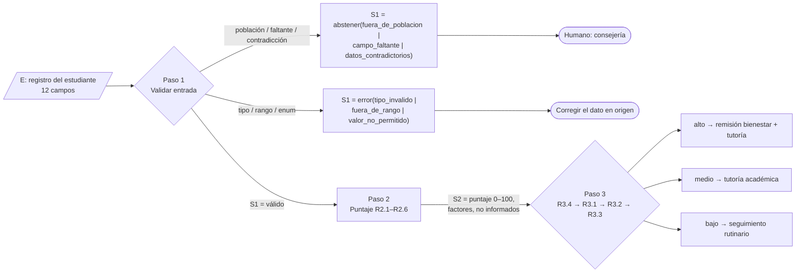
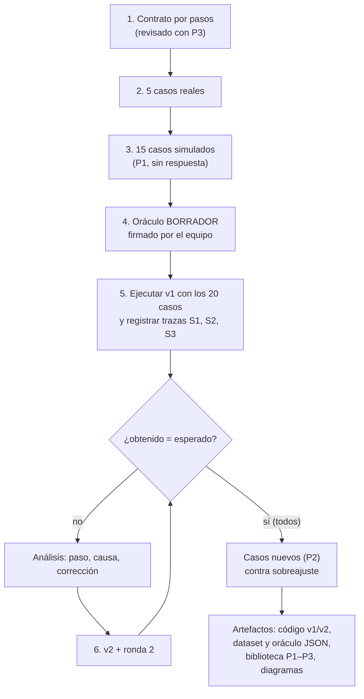

# Práctica de pruebas de estrés – Sistema de alerta temprana de deserción

> **[SUPUESTO] Sistema evaluado.** El adjunto solo traía la metodología, no el sistema. Se toma como sistema el de **alerta temprana de deserción universitaria** (proyecto de deserción en Colombia):
> - **Recibe:** el registro académico y socioeconómico de un estudiante de pregrado activo en semestres 2 a 4.
> - **Decide:** su nivel de riesgo de deserción (bajo / medio / alto) con un puntaje 0–100 por reglas.
> - **Devuelve:** nivel, puntaje, acción recomendada (seguimiento, tutoría o remisión a bienestar), factores que sumaron y datos no informados; o un error controlado, o una abstención que remite el caso a un humano (consejería).
> - Es la capa de reglas que envuelve al modelo predictivo: se prueba el contrato, no la precisión del modelo.

## Entregables del tablero

| Tablero | Sección |
|---|---|
| 1. Contrato | Paso 1 |
| 2. Simular data / 3. Data set simulado | Paso 3 |
| 3. Comprobar E y S (data típica y extrema) | Pasos 4, 5 y 6 |
| 4. Data real | Paso 2 |
| Artefacto | `sistema_v1.py`, `sistema_v2.py`, `sistema_v3.py`, `correr_rondas.py`, `correr_ronda3.py`, `dataset.py`, `dataset_r3.py` + JSON: `dataset_20_casos.json`, `dataset_ronda3.json`, `oraculo_borrador.json`, `oraculo_ronda3_borrador.json`, `resultados_rondas.json`, `resultados_ronda3.json` |
| Biblioteca P. | Paso 7 |
| Diagrama | Paso 8 |
| Iteración 2 (contrato v2 + ronda 3) | Paso 9 |

**Resumen de rondas (ejecución real):** Ronda 1 (v1) 6/20 → Ronda 2 (v2) 20/20 → Ronda 3a (v2 con 15 casos nuevos) 32/35 → Ronda 3b (v3) 35/35.

---

## Paso 1. Contrato por pasos

Cadena: **E → Paso 1 (validar) → Paso 2 (puntaje) → Paso 3 (nivel y acción)**

### Entrada E

| Campo | Tipo | Rango / valores permitidos | Obligatorio |
|---|---|---|---|
| id_estudiante | str (no vacío) | cualquier texto | Sí |
| nivel_formacion | enum (exacto, minúsculas) | pregrado, posgrado, educacion_continua | Sí |
| estado_matricula | enum (exacto) | activo, retirado, graduado | Sí |
| semestre | int (no bool) | 1 – 12 | Sí |
| promedio_acumulado | número (no bool, no NaN) | 0.0 – 5.0 | Sí |
| creditos_inscritos | int | 0 – 25 | Sí |
| materias_cursadas_periodo_anterior | int | 0 – 12 | Sí |
| materias_reprobadas | int | 0 – 12 | Sí |
| porcentaje_asistencia | número | 0.0 – 100.0 | Sí |
| estrato | int | 1 – 6 | Sí |
| trabaja | bool | true / false | Sí |
| deuda_matricula | bool | true / false | No [SUPUESTO] |

`null` equivale a "campo ausente" (no a error de tipo).

### Paso 1 – Validar entrada (S1 = `válido` o salida terminal)

Las reglas se evalúan **en este orden**; la primera que se cumple termina el proceso.

| Regla | Condición | S1 |
|---|---|---|
| R1.1a | Campo presente con tipo incorrecto (incluye bool donde va int, texto donde va número, NaN) | `error(tipo_invalido)` |
| R1.1b | Enum con valor fuera de la lista (sensible a mayúsculas) | `error(valor_no_permitido)` |
| R1.1c | Número fuera de su rango | `error(fuera_de_rango)` |
| R1.2-P1 | nivel_formacion ≠ pregrado | `abstener(fuera_de_poblacion)` |
| R1.2-P2 | estado_matricula ≠ activo | `abstener(fuera_de_poblacion)` |
| R1.2-P3 | semestre fuera de 2 ≤ s ≤ 4 [SUPUESTO: semestre 1 no tiene historial] | `abstener(fuera_de_poblacion)` |
| R1.3 | Falta un obligatorio (ausente o null) | `abstener(campo_faltante)` + lista |
| R1.4-C1 | materias_reprobadas > materias_cursadas_periodo_anterior | `abstener(datos_contradictorios)` |
| R1.4-C2 | estado = activo y creditos_inscritos = 0 | `abstener(datos_contradictorios)` |
| — | Ninguna de las anteriores | `válido` |

[SUPUESTO] Población antes que faltantes: si se sabe que alguien no pertenece, no tiene sentido pedirle datos.

### Paso 2 – Puntaje de riesgo (S2 = puntaje 0–100, factores, datos no informados)

| Regla | Condición | Puntos |
|---|---|---|
| R2.1 | promedio < 3.0 | +30 |
| R2.1 | 3.0 ≤ promedio < 3.5 | +15 |
| R2.1 | promedio ≥ 3.5 | 0 |
| R2.2 | reprobadas ≥ 2 | +25 |
| R2.2 | reprobadas = 1 | +10 |
| R2.3 | asistencia < 70 | +20 |
| R2.3 | 70 ≤ asistencia < 85 | +10 |
| R2.3 | asistencia ≥ 85 | 0 |
| R2.4 | estrato ≤ 2 | +10 |
| R2.5 | trabaja = true | +5 |
| R2.6 | deuda_matricula = true | +10 |
| R2.6 | deuda_matricula ausente | 0 y se reporta en `datos_no_informados` (no se asume false) |

Máximo = 100.

### Paso 3 – Nivel y acción (S3)

| Regla | Condición | Nivel | Acción |
|---|---|---|---|
| R3.4 (se evalúa primero) | promedio < 3.0 **y** asistencia < 70 | alto | remision_bienestar_y_tutoria |
| R3.1 | puntaje ≥ 60 | alto | remision_bienestar_y_tutoria |
| R3.2 | 30 ≤ puntaje < 60 | medio | tutoria_academica |
| R3.3 | puntaje < 30 | bajo | seguimiento_rutinario |

### Garantías del contrato
1. Nunca lanza excepción: todo termina en `resultado`, `abstener` o `error` controlado.
2. Nunca inventa datos que faltan: no asume 0, false ni vacío.
3. Nunca da un nivel de riesgo a quien está fuera de la población.
4. Los umbrales son inclusivos exactamente como están escritos (≤, ≥, <).

---

## Paso 2. Data real (5 casos típicos)

**[DATOS TÍPICOS INVENTADOS: reemplazar por reales]**
Campos comunes a todos salvo que se indique: nivel=pregrado, estado=activo, cursadas=6, trabaja=false, deuda=false, créditos=16.

| ID | semestre | promedio | reprobadas | asistencia | estrato | trabaja | deuda | otros |
|---|---|---|---|---|---|---|---|---|
| R01 | 3 | 3.8 | 0 | 92 | 3 | false | false | — |
| R02 | 2 | 3.2 | 1 | 80 | 2 | true | false | créditos 15 |
| R03 | 4 | 2.7 | 3 | 65 | 1 | true | true | cursadas 5, créditos 12 |
| R04 | 3 | 4.1 | 0 | 88 | 2 | true | *(no informado)* | — |
| R05 | 2 | 3.6 | 2 | 78 | 4 | false | true | créditos 18 |

---

## Paso 3. Data simulada (15 casos adversariales)

Base de cada caso = R01 (estudiante sano) con **solo** el cambio indicado, para aislar qué rompe cada uno. Entradas completas en `dataset_20_casos.json`. **Sin respuesta esperada.**

| ID | Categoría | Entrada (cambio sobre la base) | Por qué es difícil |
|---|---|---|---|
| S01 | Campo faltante | `promedio_acumulado` ausente | Una v1 hace `e["promedio"]` → KeyError, o asume 0 e inventa riesgo alto. |
| S02 | Campo faltante (null) | `porcentaje_asistencia: null` | La clave existe; pasa un chequeo `in` y revienta en `None < 70`, o se toma como 0 %. |
| S03 | Contradictorio | cursadas 4, reprobadas 5 | Cada campo está en rango; solo su relación es imposible. |
| S04 | Contradictorio | `creditos_inscritos: 0` (activo) | 0 está dentro del rango; la contradicción es semántica. |
| S05 | Otra población | `nivel_formacion: "posgrado"` | Datos perfectos de alguien a quien no se debe calificar. |
| S06 | Otra población | `semestre: 7` | Valor válido (1–12) pero fuera del foco temprano. |
| S07 | Otra población + faltante | `estado: "graduado"`, sin promedio | Dos motivos de abstención: prueba el orden de reglas. |
| S08 | Otra escala / rango | `promedio_acumulado: 38.0` | Escala 0–100; sin validación suma 0 y sale "bajo". |
| S09 | Otro tipo | `semestre: "3"` | Número como texto (CSV/formularios). |
| S10 | Otro tipo | `trabaja: "no"` | `"no"` es truthy en Python: suma +5 como si trabajara. |
| S11 | Valor no permitido | `nivel_formacion: "Pregrado"` | Solo cambia una mayúscula; tentación de normalizar en silencio. |
| S12 | Frontera | promedio 3.0, asistencia 70, reprobadas 1 | Dos valores justo en umbrales inclusivos. |
| S13 | Frontera | promedio 2.9, reprob. 1, asistencia 85, estrato 2, deuda true | Puntaje exacto en el corte alto/medio. |
| S14 | Frontera + excepción | promedio 2.99, asistencia 69.9, estrato 5 | Puntaje "medio" pero activa una regla de anulación. |
| S15 | Otro tipo (trampa del lenguaje) | `semestre: true` | En Python `isinstance(True, int)` es True y vale 1. |

---

## Paso 4. Oráculo – BORRADOR para que el equipo lo revise y firme

> ⚠️ Este oráculo lo escribió el modelo aplicando el contrato regla por regla. **Lo deben validar y firmar personas del equipo.** Si el mismo modelo escribe el sistema y las respuestas esperadas, la prueba mide qué tan bien se copia a sí mismo, no si el sistema funciona.

| ID | Decisión | Detalle | Regla que lo justifica |
|---|---|---|---|
| R01 | resultado | bajo, 0, seguimiento_rutinario | Nada suma → R3.3 |
| R02 | resultado | medio, 50, tutoria_academica | 15+10+10+10+5 = 50 → R3.2 |
| R03 | resultado | alto, 100, remision_bienestar_y_tutoria | 30+25+20+10+5+10 → R3.1 (y R3.4) |
| R04 | resultado | bajo, 15, seguimiento_rutinario; no informado: deuda_matricula | 10+5 → R3.3; R2.6 ausente se reporta |
| R05 | resultado | medio, 45, tutoria_academica | 25+10+10 → R3.2 |
| S01 | abstener | campo_faltante [promedio_acumulado] | R1.3 |
| S02 | abstener | campo_faltante [porcentaje_asistencia] | R1.3 (null = faltante) |
| S03 | abstener | datos_contradictorios | R1.4-C1 |
| S04 | abstener | datos_contradictorios | R1.4-C2 |
| S05 | abstener | fuera_de_poblacion | R1.2-P1 |
| S06 | abstener | fuera_de_poblacion | R1.2-P3 |
| S07 | abstener | fuera_de_poblacion | R1.2-P2 (población antes que faltantes) |
| S08 | error | fuera_de_rango (promedio_acumulado) | R1.1c, rango 0.0–5.0 |
| S09 | error | tipo_invalido (semestre) | R1.1a |
| S10 | error | tipo_invalido (trabaja) | R1.1a |
| S11 | error | valor_no_permitido (nivel_formacion) | R1.1b, enum exacto |
| S12 | resultado | medio, 35, tutoria_academica | 3.0→+15; 70→+10; 1 reprob.→+10; R3.4 no aplica (3.0 no es < 3.0) |
| S13 | resultado | alto, 60, remision_bienestar_y_tutoria | 30+10+10+10 = 60 → R3.1 (≥ 60 inclusivo) |
| S14 | resultado | alto, 50, remision_bienestar_y_tutoria | Puntaje 50, pero R3.4 fuerza alto |
| S15 | error | tipo_invalido (semestre) | R1.1a: bool no es int |

---

## Paso 5. Comprobar E y S – Ronda 1 (v1)

**v1 (`sistema_v1.py`)**: implementa solo el camino feliz de los Pasos 2 y 3 — sin validación, sin población, sin contradicciones, sin la regla R3.4, y lee `deuda_matricula` como si siempre existiera.
**Ejecución real** con `correr_rondas.py` (Python 3, sin librerías externas). Traza completa por caso (S1, S2, S3) en `resultados_rondas.json`.

| ID | Origen | Categoría | Entrada clave | Esperado | Obtenido (traza S1 → S2 → S3) | Resultado |
|---|---|---|---|---|---|---|
| R01 | real | típico | prom 3.8, asis 92 | bajo (0) | sin validar → 0 → bajo | PASA |
| R02 | real | típico | prom 3.2, asis 80 | medio (50) | sin validar → 50 → medio | PASA |
| R03 | real | típico | prom 2.7, asis 65 | alto (100) | sin validar → 100 → alto | PASA |
| R04 | real | típico | deuda ausente | bajo (15) + no inf. | **KeyError** en Paso 2 | FALLA |
| R05 | real | típico | prom 3.6, 2 reprob. | medio (45) | sin validar → 45 → medio | PASA |
| S01 | sim. | faltante | sin promedio | abstener(campo_faltante) | **KeyError** en Paso 2 | FALLA |
| S02 | sim. | faltante | asistencia null | abstener(campo_faltante) | **TypeError** en Paso 2 | FALLA |
| S03 | sim. | contradictorio | 5 reprob. de 4 | abstener(contradictorios) | sin validar → 25 → bajo | FALLA |
| S04 | sim. | contradictorio | créditos 0 | abstener(contradictorios) | sin validar → 0 → bajo | FALLA |
| S05 | sim. | población | posgrado | abstener(fuera_poblacion) | sin validar → 0 → bajo | FALLA |
| S06 | sim. | población | semestre 7 | abstener(fuera_poblacion) | sin validar → 0 → bajo | FALLA |
| S07 | sim. | población + falt. | graduado, sin prom. | abstener(fuera_poblacion) | **KeyError** en Paso 2 | FALLA |
| S08 | sim. | escala | prom 38.0 | error(fuera_de_rango) | sin validar → 0 → bajo | FALLA |
| S09 | sim. | tipo | semestre "3" | error(tipo_invalido) | sin validar → 0 → bajo | FALLA |
| S10 | sim. | tipo | trabaja "no" | error(tipo_invalido) | sin validar → 5 → bajo | FALLA |
| S11 | sim. | valor no perm. | "Pregrado" | error(valor_no_permitido) | sin validar → 0 → bajo | FALLA |
| S12 | sim. | frontera | prom 3.0, asis 70 | medio (35) | sin validar → 35 → medio | PASA |
| S13 | sim. | frontera | puntaje 60 | alto (60) | sin validar → 60 → alto | PASA |
| S14 | sim. | frontera + excep. | prom 2.99, asis 69.9 | alto (50) | sin validar → 50 → **medio** | FALLA |
| S15 | sim. | tipo | semestre true | error(tipo_invalido) | sin validar → 0 → bajo | FALLA |

**Ronda 1: 6/20 pasan** (4/5 típicos, 2/15 adversariales).

### Análisis de fallas

| ID | Paso donde falla | Causa | Corrección propuesta (v2) |
|---|---|---|---|
| R04 | 2 | `e["deuda_matricula"]` asume que el opcional existe | `e.get()`; si falta, 0 puntos y reportar en `datos_no_informados` |
| S01, S02 | 1 (inexistente) → explota en 2 | No hay chequeo de obligatorios; null no se trata como faltante | R1.3: ausente o null → `abstener(campo_faltante)` con lista |
| S03, S04 | 1 | No hay reglas de coherencia entre campos | R1.4-C1 y C2 |
| S05, S06 | 1 | No se verifica población; el sistema califica a quien no debe (falla silenciosa, la más peligrosa) | R1.2-P1/P2/P3 |
| S07 | 1 | Sin orden de reglas definido; explota por el faltante | Población antes que faltantes |
| S08 | 1 | Sin chequeo de rango: un 38 en escala 0–100 da "bajo" | R1.1c rango 0.0–5.0 |
| S09, S10 | 1 | Sin chequeo de tipo; "no" es truthy | R1.1a con `isinstance` estricto; `trabaja is True` |
| S11 | 1 | Enum no validado | R1.1b comparación exacta |
| S14 | 3 | Falta la regla de anulación R3.4 | Evaluar R3.4 antes de los cortes por puntaje |
| S15 | 1 | `isinstance(True, int)` es True en Python | Excluir bool explícitamente en campos int/num |

Observación: 11 de las 14 fallas son **silenciosas** (devuelven un "bajo" creíble) y solo 3 son excepciones. Un estudiante de posgrado o con promedio mal escalado recibiría "seguimiento rutinario" sin que nadie lo note.

---

## Paso 6. Ronda 2 (v2)

**v2 (`sistema_v2.py`)**: aplica todas las correcciones anteriores + `try/except` final que convierte cualquier imprevisto en `error(error_interno)`. **Ejecución real.**

| ID | Origen | Categoría | Entrada clave | Esperado | Obtenido (traza S1 → S2 → S3) | Resultado |
|---|---|---|---|---|---|---|
| R01 | real | típico | prom 3.8, asis 92 | bajo (0) | válido → 0 → bajo | PASA |
| R02 | real | típico | prom 3.2, asis 80 | medio (50) | válido → 50 → medio | PASA |
| R03 | real | típico | prom 2.7, asis 65 | alto (100) | válido → 100 → alto | PASA |
| R04 | real | típico | deuda ausente | bajo (15) + no inf. | válido → 15 → bajo [no inf: deuda] | PASA |
| R05 | real | típico | prom 3.6, 2 reprob. | medio (45) | válido → 45 → medio | PASA |
| S01 | sim. | faltante | sin promedio | abstener(campo_faltante) | abstener(campo_faltante) | PASA |
| S02 | sim. | faltante | asistencia null | abstener(campo_faltante) | abstener(campo_faltante) | PASA |
| S03 | sim. | contradictorio | 5 reprob. de 4 | abstener(contradictorios) | abstener(datos_contradictorios) | PASA |
| S04 | sim. | contradictorio | créditos 0 | abstener(contradictorios) | abstener(datos_contradictorios) | PASA |
| S05 | sim. | población | posgrado | abstener(fuera_poblacion) | abstener(fuera_de_poblacion) | PASA |
| S06 | sim. | población | semestre 7 | abstener(fuera_poblacion) | abstener(fuera_de_poblacion) | PASA |
| S07 | sim. | población + falt. | graduado, sin prom. | abstener(fuera_poblacion) | abstener(fuera_de_poblacion) | PASA |
| S08 | sim. | escala | prom 38.0 | error(fuera_de_rango) | error(fuera_de_rango) | PASA |
| S09 | sim. | tipo | semestre "3" | error(tipo_invalido) | error(tipo_invalido) | PASA |
| S10 | sim. | tipo | trabaja "no" | error(tipo_invalido) | error(tipo_invalido) | PASA |
| S11 | sim. | valor no perm. | "Pregrado" | error(valor_no_permitido) | error(valor_no_permitido) | PASA |
| S12 | sim. | frontera | prom 3.0, asis 70 | medio (35) | válido → 35 → medio | PASA |
| S13 | sim. | frontera | puntaje 60 | alto (60) | válido → 60 → alto | PASA |
| S14 | sim. | frontera + excep. | prom 2.99, asis 69.9 | alto (50) | válido → 50 → alto (R3.4) | PASA |
| S15 | sim. | tipo | semestre true | error(tipo_invalido) | error(tipo_invalido) | PASA |

**Ronda 2: 20/20 pasan.**

Lectura honesta del 20/20: v2 se corrigió **mirando estos mismos 20 casos**, así que el resultado muestra que se arreglaron los fallos conocidos, no que el sistema sea robusto. Para eso hace falta un set nuevo (P2) y, sobre todo, el oráculo firmado por el equipo. Además quedan huecos que ningún caso cubre (ver "Cosas a revisar"): por ejemplo, una asistencia enviada como proporción (0.92 en vez de 92) es válida por contrato y v2 la calificaría como asistencia < 70.

---

## Paso 7. Biblioteca de prompts

### P1 – Generar 15 casos adversariales
- **Propósito:** crear el dataset simulado a partir del contrato y los 5 reales.
- **Cuándo usarlo:** apenas el contrato está escrito, antes de programar o probar.
- **Regla clave:** prohibido incluir la respuesta esperada.

```
Actúa como ingeniero(a) de pruebas. Abajo están el CONTRATO de un sistema (entrada,
pasos, reglas y garantías) y 5 casos REALES típicos.
Genera 15 entradas nuevas (IDs S01–S15) diseñadas para ROMPER un sistema construido
sobre ese contrato. Cubre al menos: campos faltantes (ausente y null), campos
contradictorios entre sí, entradas de otra población, valores fuera de rango o de
otro tipo/escala, valores exactamente en cada umbral, y casos donde lo correcto es
abstenerse. Parte de un caso real y cambia lo mínimo para aislar cada ataque.
Entrega una tabla: ID | categoría | entrada completa (JSON) | por qué es difícil.
NO incluyas la respuesta esperada ni pistas de ella.
CONTRATO: <pegar>
CASOS REALES: <pegar>
```

### P2 – 15 casos nuevos para la ronda 2
- **Propósito:** atacar las correcciones desde otro ángulo y detectar sobreajuste a los casos viejos.
- **Cuándo usarlo:** después de corregir y obtener un buen puntaje en la ronda 2.
- **Regla clave:** ningún caso puede repetir una entrada ya usada; debe atacar la *causa* de un fallo, no su síntoma.

```
Abajo están el CONTRATO, los 20 casos ya usados y la lista de fallas de la ronda 1
con su causa y corrección. Genera 15 casos NUEVOS (IDs T01–T15) que ataquen cada
corrección desde otro ángulo: otro campo con el mismo tipo de error, combinaciones
de dos errores a la vez, el lado opuesto de cada umbral (valor justo por debajo y
justo por encima), unidades o escalas confundidas que sigan dentro de rango, y
textos con espacios, mayúsculas o caracteres especiales. No repitas ninguna entrada
anterior. Tabla: ID | falla que ataca | entrada completa | por qué podría pasar la
corrección y aun así estar mal. Sin respuesta esperada.
CONTRATO: <pegar>  CASOS USADOS: <pegar>  FALLAS: <pegar>
```

### P3 – Revisar el contrato antes de probar
- **Propósito:** encontrar ambigüedades antes de que se conviertan en discusiones sobre el oráculo.
- **Cuándo usarlo:** antes del Paso 2, y cada vez que cambie el contrato.
- **Regla clave:** no corregir el contrato, solo listar preguntas; las decide el equipo.

```
Revisa este CONTRATO como auditor(a), sin reescribirlo. Lista en una tabla
(ubicación | tipo de ambigüedad | ejemplo de entrada que la expone | pregunta para el equipo):
1) umbrales sin indicar si son inclusivos o con huecos/solapes entre rangos;
2) campos sin tipo, sin rango o sin decir si son obligatorios;
3) combinaciones de valores que ninguna regla cubre o que activan dos reglas;
4) orden de evaluación no definido entre errores, población, faltantes y contradicciones;
5) dudas de abstención: casos en que no está claro si decidir, abstenerse o dar error;
6) cómo se trata null, vacío, NaN, booleanos y texto numérico.
CONTRATO: <pegar>
```

---

## Paso 8. Diagramas (Mermaid)

### Diagrama A – El sistema por pasos



### Diagrama B – Proceso de la práctica



---

## Paso 9. Iteración 2 – Contrato v2 y ronda 3

El 20/20 de la ronda 2 se obtuvo sobre los mismos casos usados para corregir. Esta iteración lo pone a prueba: **(a)** revisar el contrato con P3, **(b)** generar 15 casos nuevos con P2, **(c)** escribir su oráculo aparte, **(d)** correr v2 sin tocarla, **(e)** corregir en v3 y correr los 35 casos.

### 9.1 Revisión del contrato con P3

| Ubicación | Ambigüedad encontrada | Entrada que la expone | Decisión para contrato v2 |
|---|---|---|---|
| R1.1 / asistencia | La unidad no está fijada: 0–1 y 0–100 caben en el mismo rango | asistencia 0.92 | **R1.4-C3 (nuevo):** 0 < asistencia ≤ 1.0 → `abstener(datos_contradictorios)` [SUPUESTO] |
| R1.3 / textos | ¿Un texto vacío o solo con espacios es error de tipo o faltante? | id_estudiante "   " | **R1.3 ampliada:** vacío o solo espacios = faltante [SUPUESTO] |
| R1.4 / evidencia | Un 0 en reprobadas se lee como "bueno" aunque no haya materias cursadas | semestre 3, cursadas 0 | **R1.4-C4 (nuevo):** semestre ≥ 2 y cursadas = 0 → `abstener(datos_contradictorios)` [SUPUESTO; reintegros los revisa un humano] |
| R1.1 / varios errores | No dice cuál error reportar si hay dos | semestre "3" y promedio 38 | Se reporta el primero en el orden de la tabla E (ya lo hacía v2; ahora queda escrito) |
| E / claves extra | No dice qué hacer con campos desconocidos | "Promedio_acumulado" | **R1.0 (nuevo):** se ignoran; nunca se usan como sustituto de un campo del contrato |
| R1.1 / formato local | Decimales con coma | promedio "3,8" | Es texto → `tipo_invalido`; la conversión se hace en origen |

Las tres reglas nuevas no cambian ningún resultado esperado de los 20 casos anteriores (ninguno tiene asistencia ≤ 1, textos vacíos ni 0 materias cursadas).

### 9.2 Data simulada – ronda 3 (generada con P2, sin respuesta esperada)

Base = R01 con solo el cambio indicado. Cada caso ataca una corrección anterior desde otro ángulo.

| ID | Corrección que ataca | Categoría | Entrada (cambio sobre la base) | Por qué es difícil |
|---|---|---|---|---|
| T01 | S08 (escala), ahora dentro de rango | otra escala | asistencia 0.92 | Proporción 0–1: pasa el rango y se lee como 0,92 % |
| T02 | S09 (tipo), formato local | otro tipo | promedio "3,8" | Decimal con coma, típico de Excel en Colombia |
| T03 | S15 (tipo), float entero | otro tipo | semestre 3.0 | `3.0 == 3` en Python |
| T04 | S10 (bool), entero | otro tipo | trabaja 1 | `1 == True` en Python |
| T05 | S11 (enum), espacio | valor no permitido | nivel "pregrado " | Invisible al ojo |
| T06 | S01 (faltante), disfrazado | campo faltante | id_estudiante "   " | La clave existe y es texto, pero vacía |
| T07 | S01 (faltante), clave mal escrita | campo faltante | "Promedio_acumulado": 3.8 (sin la clave correcta) | El dato "está", con otro nombre |
| T08 | orden entre errores | dos errores | semestre "3" + promedio 38 | ¿Cuál se reporta? |
| T09 | orden error vs. población | error + población | posgrado + estrato 9 | Dos motivos de distinto tipo |
| T10 | orden población vs. contradicción | población + contradictorio | retirado + 0 créditos | Coherente para retirado, contradictorio para activo |
| T11 | S03, frontera de C1 | frontera | reprobadas 6 de 6 | Justo en el límite (> estricto) |
| T12 | S04, sin evidencia | abstenerse | cursadas 0, reprobadas 0, semestre 3 | "0 reprobadas" parece bueno sin serlo |
| T13 | S12, lado opuesto | frontera | semestre 4, promedio 3.5, asistencia 84.99 | Tres bordes a la vez |
| T14 | S14 (R3.4), lado opuesto | frontera + excepción | promedio 2.99, asistencia 70.0 | Cumple solo una condición de R3.4 |
| T15 | S13, corte inferior | frontera | promedio 2.9 | Puntaje exactamente 30 |

### 9.3 Oráculo ronda 3 – BORRADOR para que el equipo lo revise y firme

> Igual que el oráculo del Paso 4: lo escribió el modelo con el contrato v2 y lo deben validar personas.

| ID | Decisión | Detalle | Regla |
|---|---|---|---|
| T01 | abstener | datos_contradictorios | R1.4-C3 (nuevo) |
| T02 | error | tipo_invalido (promedio_acumulado) | R1.1a |
| T03 | error | tipo_invalido (semestre) | R1.1a: float no es int |
| T04 | error | tipo_invalido (trabaja) | R1.1a: int no es bool |
| T05 | error | valor_no_permitido (nivel_formacion) | R1.1b |
| T06 | abstener | campo_faltante [id_estudiante] | R1.3 ampliada |
| T07 | abstener | campo_faltante [promedio_acumulado] | R1.3 + R1.0 |
| T08 | error | tipo_invalido (semestre) | Primer error en orden de la tabla E |
| T09 | error | fuera_de_rango (estrato) | Formato antes que población |
| T10 | abstener | fuera_de_poblacion | R1.2-P2 antes que R1.4 |
| T11 | resultado | bajo, 25, seguimiento_rutinario | C1 no aplica (6 no es > 6); R2.2 +25 |
| T12 | abstener | datos_contradictorios | R1.4-C4 (nuevo) |
| T13 | resultado | bajo, 10, seguimiento_rutinario | Semestre 4 incluido; 3.5 → 0; 84.99 → +10 |
| T14 | resultado | medio, 40, tutoria_academica | 30+10; R3.4 no aplica (70 no es < 70) |
| T15 | resultado | medio, 30, tutoria_academica | ≥ 30 inclusivo |

### 9.4 Ronda 3a – v2 sin cambios contra los 35 casos (ejecución real)

Los 20 casos anteriores: **20/20 PASA** (no hubo regresiones). Casos nuevos:

| ID | Esperado | Obtenido (traza S1 → S2 → S3) | Resultado |
|---|---|---|---|
| T01 | abstener(contradictorios) | válido → 20 → bajo | **FALLA** |
| T02 | error(tipo_invalido) | error(tipo_invalido) | PASA |
| T03 | error(tipo_invalido) | error(tipo_invalido) | PASA |
| T04 | error(tipo_invalido) | error(tipo_invalido) | PASA |
| T05 | error(valor_no_permitido) | error(valor_no_permitido) | PASA |
| T06 | abstener(campo_faltante) | error(tipo_invalido) | **FALLA** |
| T07 | abstener(campo_faltante) | abstener(campo_faltante) | PASA |
| T08 | error(tipo_invalido) | error(tipo_invalido) | PASA |
| T09 | error(fuera_de_rango) | error(fuera_de_rango) | PASA |
| T10 | abstener(fuera_de_poblacion) | abstener(fuera_de_poblacion) | PASA |
| T11 | bajo (25) | válido → 25 → bajo | PASA |
| T12 | abstener(contradictorios) | válido → 0 → bajo | **FALLA** |
| T13 | bajo (10) | válido → 10 → bajo | PASA |
| T14 | medio (40) | válido → 40 → medio | PASA |
| T15 | medio (30) | válido → 30 → medio | PASA |

**Ronda 3a: 32/35 pasan** (reales 5/5, simulados 15/15, nuevos 12/15).

| ID | Paso | Causa | Corrección en v3 |
|---|---|---|---|
| T01 | 1 | Contrato v1 sin unidad fija; v2 califica una asistencia de 0,92 % como real → falla silenciosa | Regla R1.4-C3 |
| T06 | 1 | v2 trata el texto vacío como tipo inválido; el contrato v2 lo define como faltante (el error correcto es pedir el dato, no culpar al formato) | Normalizar vacío/espacios a `null` antes de validar |
| T12 | 1 | Contrato v1 no exigía evidencia: sin materias cursadas, el estudiante sale "bajo" por falta de datos | Regla R1.4-C4 |

Lectura: las 3 fallas vienen de **huecos del contrato**, no de errores de programación. El código de v2 resistió los 12 ataques de tipo, orden y frontera. Esto confirma que P3 (revisar el contrato) encuentra cosas que ninguna cantidad de código corrige.

### 9.5 Ronda 3b – v3 contra los 35 casos (ejecución real)

`sistema_v3.py` = v2 + normalización de textos vacíos + C3 + C4 (marcados `# FIX T01/T06/T12`).

| Grupo | Pasan |
|---|---|
| Reales R01–R05 | 5/5 |
| Simulados S01–S15 | 15/15 |
| Nuevos T01–T15 | 15/15 |
| **Total** | **35/35** |

Detalle caso por caso en `resultados_ronda3.json`.

**Lectura honesta:** el 35/35 vuelve a medirse sobre casos que ya se conocían al corregir. El patrón de esta iteración (las fallas pasaron del código al contrato) sugiere que el siguiente riesgo está en las reglas de negocio, no en la validación. Antes de otra ronda conviene que el equipo firme los dos oráculos y las tres reglas nuevas.

---

## Cosas a revisar antes de entregar

| # | Punto | Qué hacer |
|---|---|---|
| 1 | [SUPUESTO] El sistema evaluado es el de alerta temprana de deserción, porque el adjunto no traía uno. | Confirmar o reemplazar por el sistema asignado. |
| 2 | [SUPUESTO] Población = pregrado, activo, semestres 2–4 (semestre 1 sin historial). | Validar con el docente/equipo. |
| 3 | [SUPUESTO] `deuda_matricula` es opcional; el resto obligatorio. | Confirmar. |
| 4 | [SUPUESTO] Orden de Paso 1: formato → población → faltantes → contradicciones. | Confirmar (afecta S07). |
| 5 | [SUPUESTO] Pesos, umbrales y regla R3.4 son ilustrativos, no calibrados con datos. | Reemplazar por los del modelo real o justificarlos. |
| 6 | [SUPUESTO] Enums sensibles a mayúsculas (S11 → error, no se normaliza). | Decidir si se normaliza. |
| 7 | [SUPUESTO] R1.4-C3: asistencia entre 0 y 1 se trata como escala equivocada. Efecto colateral: un 1 % real también se abstiene. | Mejor solución de fondo: fijar la unidad en el sistema de origen. |
| 8 | [SUPUESTO] R1.4-C4: semestre ≥ 2 sin materias cursadas → abstener. Afecta reintegros y aplazamientos. | Confirmar con bienestar/registro. |
| 9 | [SUPUESTO] R1.3 ampliada: texto vacío = faltante; R1.0: claves desconocidas se ignoran. | Confirmar. |
| 10 | Los datos "reales" R01–R05 son **inventados**. | Reemplazar por registros reales anonimizados. |
| 11 | Los dos oráculos (Paso 4 y 9.3) son **borradores escritos por el modelo**. | El equipo los revisa y firma antes de dar por válidas las rondas. |
| 12 | El 35/35 de v3 se logró sobre casos conocidos al corregir. | Para una ronda 4: casos sobre reglas de negocio (pesos, R3.4, población) y, si hay, registros reales. |
