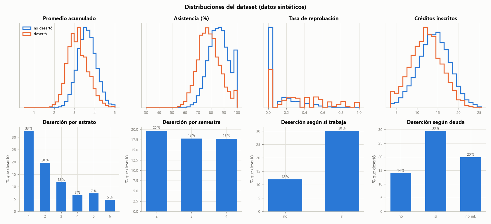

# Resumen del dataset sintético

> ⚠️ **Datos sintéticos.** Todo lo que aparece aquí se midió con estudiantes simulados. Describe qué tan bien el proceso recupera una función inventada, **no** el desempeño con estudiantes reales.

Generado por `python -m desercion.entrenamiento` (módulo `desercion/datos_sinteticos.py`).

## Tamaño y tasa de deserción

| Concepto | Valor |
|---|---|
| Registros generados | 20619 |
| Válidos (pasan el Paso 1) | 20000 |
| Descartados por el Paso 1 | 619 |
| Defectuosos que el Paso 1 dejó pasar | 0 |
| Tasa de deserción (válidos) | 18.3 % |
| Tasa objetivo [SUPUESTO] | 18.0 % |
| Válidos sin `deuda_matricula` (opcional, se conservan) | 1624 |
| CSV guardado y recargado con `cargar_datos_reales()` | idéntico |
| AUC de la probabilidad real en test (techo teórico) | 0.846 |

## División train / validación / test (estratificada, semilla 2026)

| Conjunto | Registros | Tasa de deserción |
|---|---|---|
| train | 14000 | 18.3 % |
| validación | 3000 | 18.3 % |
| test | 3000 | 18.3 % |

## Registros descartados por el Paso 1

Cada registro defectuoso pasa por la misma validación del contrato que usa el sistema. Ninguno entra al entrenamiento.

| Salida del Paso 1 | Registros |
|---|---|
| abstener(campo_faltante) | 156 |
| abstener(datos_contradictorios) | 154 |
| abstener(fuera_de_poblacion) | 77 |
| error(fuera_de_rango) | 77 |
| error(tipo_invalido) | 155 |

Cruce entre el defecto introducido y la salida del Paso 1:

| Defecto introducido | Salida del Paso 1 | Registros |
|---|---|---|
| bool_texto | error(tipo_invalido) | 77 |
| contradictorio | abstener(datos_contradictorios) | 77 |
| escala_asistencia | abstener(datos_contradictorios) | 77 |
| faltante | abstener(campo_faltante) | 78 |
| fuera_de_rango | error(fuera_de_rango) | 77 |
| nulo | abstener(campo_faltante) | 78 |
| otra_poblacion | abstener(fuera_de_poblacion) | 77 |
| tipo_texto | error(tipo_invalido) | 78 |

## Distribución de las variables numéricas

| Campo | Media | Desv. | Mín | P25 | Mediana | P75 | Máx | Media desertores | Media no desertores |
|---|---|---|---|---|---|---|---|---|---|
| semestre | 3.00 | 0.81 | 2.00 | 2.00 | 3.00 | 4.00 | 4.00 | 2.97 | 3.01 |
| promedio_acumulado | 3.53 | 0.50 | 1.45 | 3.20 | 3.54 | 3.87 | 5.00 | 3.17 | 3.62 |
| creditos_inscritos | 13.70 | 3.89 | 4.00 | 11.00 | 14.00 | 16.00 | 25.00 | 12.19 | 14.04 |
| materias_cursadas_periodo_anterior | 5.46 | 1.18 | 3.00 | 5.00 | 5.00 | 6.00 | 8.00 | 5.29 | 5.50 |
| materias_reprobadas | 0.83 | 1.21 | 0.00 | 0.00 | 0.00 | 1.00 | 8.00 | 1.74 | 0.63 |
| porcentaje_asistencia | 84.46 | 8.49 | 47.10 | 78.70 | 84.60 | 90.40 | 100.00 | 78.39 | 85.82 |
| estrato | 2.45 | 1.17 | 1.00 | 2.00 | 2.00 | 3.00 | 6.00 | 1.92 | 2.57 |

## Variables categóricas y deserción por grupo

**estrato**

| Valor | Registros | % del total | % que desertó |
|---|---|---|---|
| 1 | 4415 | 22.1 % | 32.6 % |
| 2 | 6980 | 34.9 % | 19.7 % |
| 3 | 5393 | 27.0 % | 11.9 % |
| 4 | 2006 | 10.0 % | 6.6 % |
| 5 | 801 | 4.0 % | 7.2 % |
| 6 | 405 | 2.0 % | 4.7 % |

**semestre**

| Valor | Registros | % del total | % que desertó |
|---|---|---|---|
| 2 | 6604 | 33.0 % | 19.6 % |
| 3 | 6722 | 33.6 % | 17.7 % |
| 4 | 6674 | 33.4 % | 17.7 % |

**trabaja**

| Valor | Registros | % del total | % que desertó |
|---|---|---|---|
| false | 12990 | 65.0 % | 12.0 % |
| true | 7010 | 35.0 % | 30.1 % |

**deuda_matricula**

| Valor | Registros | % del total | % que desertó |
|---|---|---|---|
| false | 13446 | 67.2 % | 14.0 % |
| true | 4930 | 24.6 % | 29.5 % |
| no_informado | 1624 | 8.1 % | 19.9 % |

## Fórmula con la que se generó la etiqueta [SUPUESTO]

`z = b0 + 1.8·bisagra(3.3 - promedio) + 2.2·tasa_reprobacion + 0.0009·max(0, 92 - asistencia)² + 0.25·trabaja + 1.10·trabaja·sigmoide((78 - asistencia)/3) + 0.22·max(0, 4 - estrato) + 0.35·deuda + 0.45·deuda·[estrato ≤ 2] + 0.20·[semestre = 2] - 0.05·(créditos - 15) + N(0, 0.6)`

con b0 = -3.676 (ajustado para una tasa de 18.0 %), `p = sigmoide(z)` y `deserto ~ Bernoulli(p)`.

