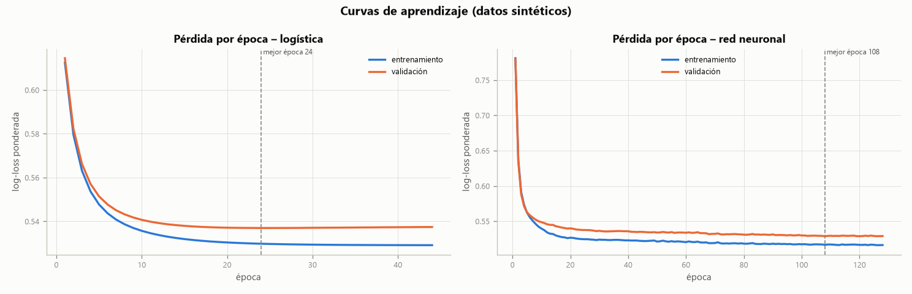
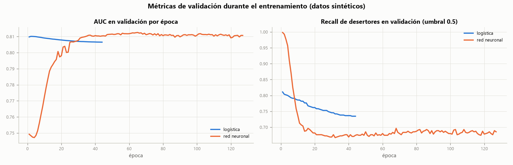
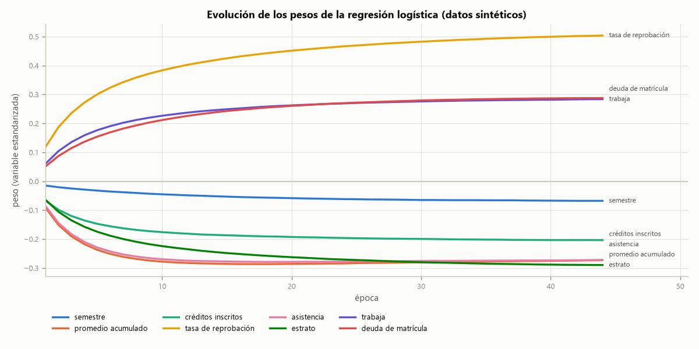
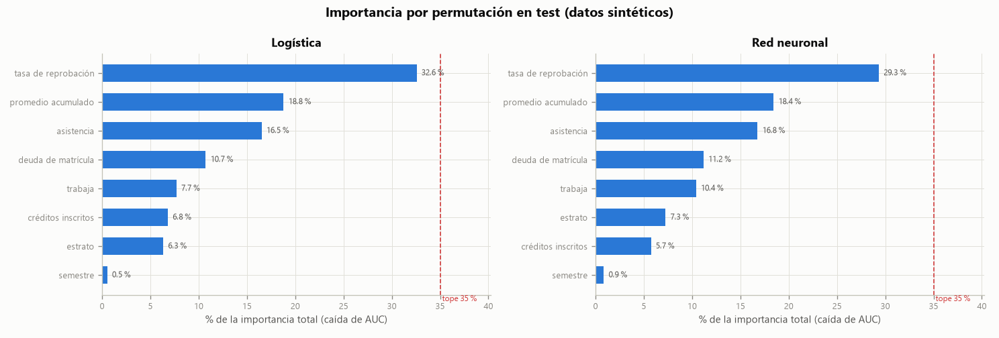
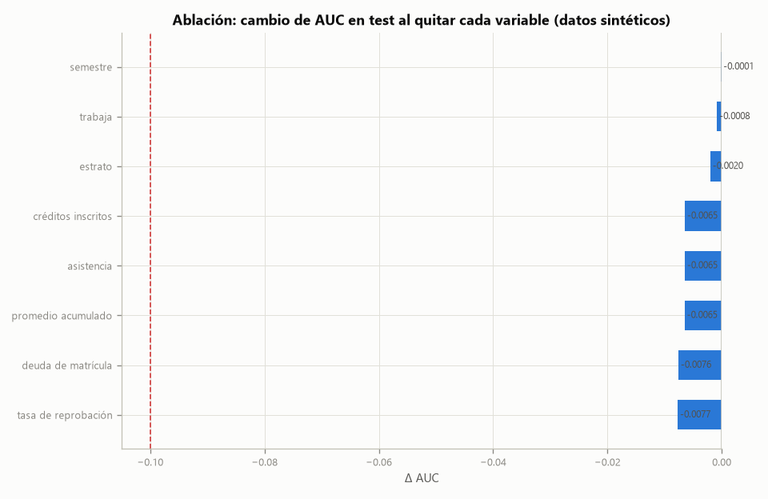
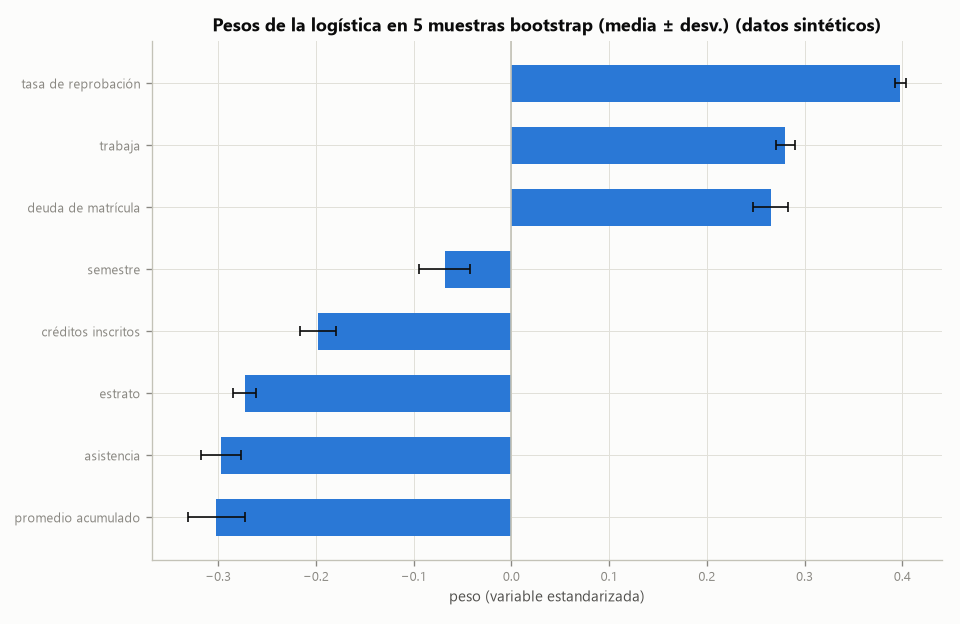
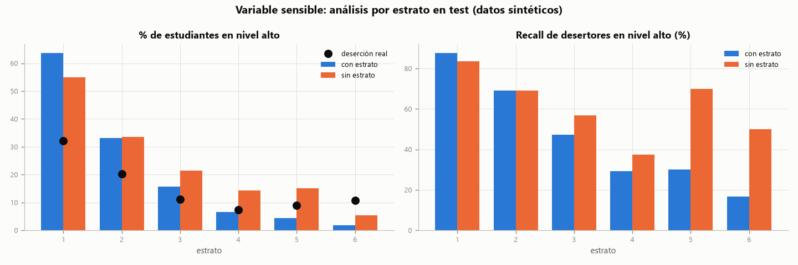
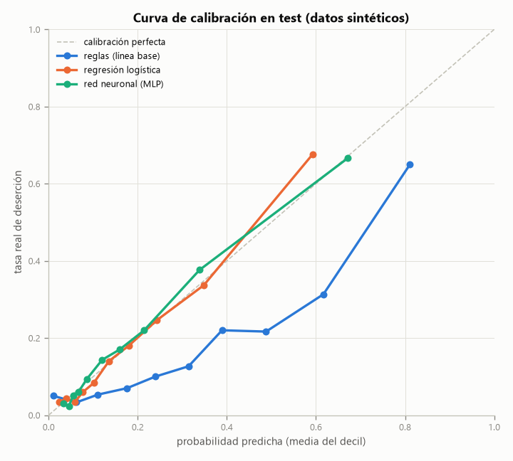

# Reporte de entrenamiento – sistema de alerta temprana de deserción

> ⚠️ **Datos sintéticos.** Todo lo que aparece aquí se midió con estudiantes simulados. Describe qué tan bien el proceso recupera una función inventada, **no** el desempeño con estudiantes reales.

Generado automáticamente por `python -m desercion.entrenamiento` con semilla 2026. Los números de este documento salen de esa ejecución.

## Resumen

| Métrica en test | reglas (línea base) | regresión logística | red neuronal (MLP) |
|---|---|---|---|
| Log-loss (↓) | 0.4552 | 0.3653 | 0.3616 |
| Brier (↓) | 0.1453 | 0.1114 | 0.1100 |
| AUC-ROC (↑) | 0.7931 | 0.8170 | 0.8232 |
| Recall de desertores (nivel alto) | 51.1 % | 69.6 % | 69.6 % |
| Precisión (nivel alto) | 51.1 % | 42.0 % | 43.0 % |
| Accuracy (nivel alto = riesgo) | 82.1 % | 76.8 % | 77.5 % |
| % de estudiantes en alto | 18.3 % | 30.4 % | 29.7 % |

Techo teórico (AUC de la probabilidad real que generó los datos): **0.8459**.

**Conclusión.** La red neuronal ordena algo mejor que la logística (AUC 0.823 vs 0.817), a costa de perder la tarjeta de puntaje explicable. La línea base por reglas queda cerca (AUC 0.793, +0.024 frente a la logística) y su probabilidad (puntaje/100) está mal calibrada (Brier 0.145 vs 0.111). Ningún modelo puede pasar de ~0.846 de AUC porque el resto es ruido de la simulación. Todo se midió con datos SINTÉTICOS: no representa el desempeño con estudiantes reales.

# Cómo se asignan los pesos de las variables

## 1. Cómo se generaron los datos y por qué son sintéticos

No hay registros reales de estudiantes con la etiqueta de si desertaron, así que se simularon 20619 registros. 20000 son válidos y 619 tienen defectos a propósito (faltantes, tipos malos, fuera de rango, otra población, contradicciones); el Paso 1 del contrato los descartó todos (0 se colaron). Detalle en [datos_resumen.md](datos_resumen.md).

Las variables salen de dos factores ocultos correlacionados (socioeconómico y académico), así que están relacionadas como en la vida real: un promedio bajo va con más materias perdidas y menos asistencia, y un estrato bajo va con más trabajo y más deuda.

La etiqueta **no** se generó con las reglas del contrato (si así fuera, el modelo solo las copiaría). Se usó esta función latente, no lineal, con interacciones y ruido [SUPUESTO]:

`z = b0 + 1.8·bisagra(3.3 - promedio) + 2.2·tasa_reprobacion + 0.0009·max(0, 92 - asistencia)² + 0.25·trabaja + 1.10·trabaja·sigmoide((78 - asistencia)/3) + 0.22·max(0, 4 - estrato) + 0.35·deuda + 0.45·deuda·[estrato ≤ 2] + 0.20·[semestre = 2] - 0.05·(créditos - 15) + N(0, 0.6)`

con b0 = -3.676, ajustado para una tasa de deserción de 18.0 % (resultó 18.3 %). Como hay ruido, ni siquiera la probabilidad real ordena perfecto: su AUC en test es 0.846. Ese es el techo de cualquier modelo.

## 2. Época, mini-lote, pérdida y gradiente (con este sistema como ejemplo)

- **Ejemplo de entrenamiento:** un estudiante del conjunto de train (14000 en total) descrito por 8 números: semestre, promedio_acumulado, creditos_inscritos, tasa_reprobacion, porcentaje_asistencia, estrato, trabaja, deuda_matricula.
- **Mini-lote:** 256 estudiantes. Con cada lote se calcula cuánto se equivoca el modelo y se corrigen los pesos una vez (≈ 55 correcciones por época).
- **Época:** una pasada por los 14000 estudiantes. La logística corrió 44 épocas y se quedó con la 24; la red corrió 127 y se quedó con la 107.
- **Pérdida (entropía cruzada):** si el modelo le da 0.9 de probabilidad a un estudiante que sí desertó, la pérdida es −ln(0.9) = 0.105; si le da 0.1, es −ln(0.1) = 2.303. Equivocarse con seguridad cuesta mucho. Como hay pocos desertores, cada uno pesa 2.73 y cada no desertor 0.61 (pesos por clase); así el modelo no aprende a decir "nadie deserta".
- **Gradiente:** para cada peso, cuánto cambia la pérdida si el peso sube un poco. En la logística es `Σ s·(p − y)·x / Σ s + λ·w`: si el modelo subestima el riesgo de los desertores (p < y) en estudiantes con tasa de reprobación alta (x > 0), el gradiente es negativo y el peso de la tasa sube.
- **Paso:** `w ← w − η·gradiente`, con η = 0.01 en la logística (SGD) y Adam con η = 0.001 en la red (backpropagation programado a mano y verificado contra diferencias finitas: `python pruebas/verificar_modelos.py`).

## 3. Cómo cambiaron los pesos de cada variable

Pesos de la regresión logística sobre variables estandarizadas (1 unidad = 1 desviación estándar):

| Variable | Época 1 | Época 24 (mejor) | Final (tras tope) | Parte de |pesos| final |
|---|---|---|---|---|
| semestre | -0.015 | -0.062 | -0.065 | 3.1 % |
| promedio acumulado | -0.092 | -0.284 | -0.310 | 14.6 % |
| créditos inscritos | -0.067 | -0.196 | -0.202 | 9.5 % |
| tasa de reprobación | +0.119 | +0.466 | +0.413 | 19.5 % |
| asistencia | -0.087 | -0.278 | -0.289 | 13.6 % |
| estrato | -0.064 | -0.271 | -0.286 | 13.5 % |
| trabaja | +0.061 | +0.269 | +0.272 | 12.8 % |
| deuda de matrícula | +0.051 | +0.270 | +0.281 | 13.3 % |

Todos los pesos arrancan cerca de 0 y crecen en la dirección esperada: la tasa de reprobación, trabajar y la deuda suben el riesgo; el promedio, la asistencia, el estrato y los créditos lo bajan.

La gráfica muestra el primer entrenamiento, antes del tope de dominancia; la columna "Final" de la tabla ya lo incluye.

## 4. Qué hizo cada técnica contra la dependencia excesiva

| Técnica | Qué hace | Efecto medido |
|---|---|---|
| Tratar la colinealidad | Quita variables casi duplicadas antes de entrenar | se quitó `materias_reprobadas` (r = 0.965 con `tasa_reprobacion`); se quitó `materias_cursadas_periodo_anterior` (r = 0.804 con `creditos_inscritos`). VIF máximo 21.2 → 2.2 |
| Estandarización | Media 0 y desviación 1 con datos de train | Sin escalar, la asistencia (0–100) daría gradientes ~20 veces mayores que el promedio (0–5) y L2 castigaría según las unidades |
| L2 (weight decay) | Penaliza pesos grandes: λ = 0.001 (logística), 0.0001 (red) | Norma de pesos de la logística en la mejor época: 0.798 |
| Dropout | Apaga 20% de las neuronas ocultas al azar en cada lote | La red no se apoya en una sola variable: su variable más importante pesa 25.4 % |
| Early stopping | Para si la pérdida de validación no mejora en 20 épocas | Logística: mejor época 24 de 44; red: 107 de 127 |
| Tope de dominancia (35 %) | Si una variable supera el tope, se sube su L2 y se reentrena | `tasa_reprobacion` pasó de 36.7 % a 31.5 % de la importancia (train) con L2 ×32; AUC test 0.8166 → 0.8170 |

### Importancia por permutación en test

Se desordena una variable a la vez y se mide cuánto cae el AUC (5 repeticiones).

| Variable | Logística (caída AUC) | Logística (% total) | Red (caída AUC) | Red (% total) |
|---|---|---|---|---|
| semestre | 0.0007 ± 0.0006 | 0.5 % | 0.0043 ± 0.0013 | 3.1 % |
| promedio acumulado | 0.0235 ± 0.0030 | 18.8 % | 0.0351 ± 0.0029 | 24.9 % |
| créditos inscritos | 0.0085 ± 0.0017 | 6.8 % | 0.0067 ± 0.0016 | 4.7 % |
| tasa de reprobación | 0.0407 ± 0.0040 | 32.6 % | 0.0358 ± 0.0036 | 25.4 % |
| asistencia | 0.0207 ± 0.0015 | 16.5 % | 0.0199 ± 0.0019 | 14.1 % |
| estrato | 0.0079 ± 0.0032 | 6.3 % | 0.0083 ± 0.0021 | 5.9 % |
| trabaja | 0.0096 ± 0.0018 | 7.7 % | 0.0159 ± 0.0023 | 11.3 % |
| deuda de matrícula | 0.0134 ± 0.0032 | 10.7 % | 0.0152 ± 0.0030 | 10.7 % |

### Pasos del tope de dominancia

La primera versión decidía el tope con la importancia en validación (3 000 registros): ahí la tasa de reprobación daba 33.5 % (dentro del tope), pero en test daba 37.7 % y en 5 muestras bootstrap 39.5 %. Con tan pocos registros la medida es ruidosa, así que ahora se decide con train (14 000) y un margen de 2 puntos.

| Paso | Variable | L2 × | λ efectivo | Peso | Máx. % (train) | AUC val |
|---|---|---|---|---|---|---|
| 1 | tasa_reprobacion | 2 | 0.002 | +0.464 | 36.5 % (tasa_reprobacion) | 0.8075 |
| 2 | tasa_reprobacion | 4 | 0.004 | +0.460 | 36.1 % (tasa_reprobacion) | 0.8075 |
| 3 | tasa_reprobacion | 8 | 0.008 | +0.456 | 35.7 % (tasa_reprobacion) | 0.8076 |
| 4 | tasa_reprobacion | 16 | 0.016 | +0.440 | 34.2 % (tasa_reprobacion) | 0.8078 |
| 5 | tasa_reprobacion | 32 | 0.032 | +0.413 | 31.5 % (tasa_reprobacion) | 0.8080 |

Costo de repartir el peso, en test: AUC 0.8166 → 0.8170, log-loss 0.3651 → 0.3653.

### Ablación (reentrenar sin una variable)

| Sin la variable | AUC test | Δ AUC | Log-loss test | Δ log-loss | ¿Colapsa? |
|---|---|---|---|---|---|
| semestre | 0.8168 | -0.0001 | 0.3654 | +0.0001 | no |
| promedio acumulado | 0.8104 | -0.0065 | 0.3695 | +0.0042 | no |
| créditos inscritos | 0.8105 | -0.0065 | 0.3689 | +0.0036 | no |
| tasa de reprobación | 0.8092 | -0.0077 | 0.3755 | +0.0101 | no |
| asistencia | 0.8105 | -0.0065 | 0.3698 | +0.0045 | no |
| estrato | 0.8149 | -0.0020 | 0.3668 | +0.0015 | no |
| trabaja | 0.8161 | -0.0008 | 0.3673 | +0.0020 | no |
| deuda de matrícula | 0.8094 | -0.0076 | 0.3706 | +0.0053 | no |

Ninguna variable hace colapsar al modelo (umbral: caída de AUC > 0.10) 
Las caídas son pequeñas porque las variables correlacionadas cubren en parte a la que falta.

### Estabilidad (5 muestras bootstrap de train)

| Variable | Peso medio ± desv. | Importancia logística | Importancia red (5 semillas) |
|---|---|---|---|
| semestre | -0.068 ± 0.026 | 0.3 % ± 0.1 % | 1.5 % ± 0.5 % |
| promedio acumulado | -0.302 ± 0.029 | 16.0 % ± 2.2 % | 19.4 % ± 1.4 % |
| créditos inscritos | -0.198 ± 0.018 | 7.9 % ± 0.8 % | 6.8 % ± 0.9 % |
| tasa de reprobación | +0.398 ± 0.006 | 34.5 % ± 1.3 % | 29.4 % ± 0.6 % |
| asistencia | -0.297 ± 0.021 | 15.5 % ± 1.8 % | 13.8 % ± 0.3 % |
| estrato | -0.273 ± 0.012 | 9.0 % ± 0.5 % | 9.8 % ± 0.4 % |
| trabaja | +0.280 ± 0.010 | 8.3 % ± 0.3 % | 10.6 % ± 0.3 % |
| deuda de matrícula | +0.265 ± 0.018 | 8.5 % ± 0.6 % | 8.7 % ± 0.2 % |

Variables cuyo peso cambia de signo entre muestras: ninguna.

### Variable sensible: estrato

| Estrato | n | Deserción real | % alto (con) | % alto (sin) | Recall (con) | Recall (sin) | Log-loss (con) | Log-loss (sin) |
|---|---|---|---|---|---|---|---|---|
| 1 | 656 | 32.2 % | 63.7 % | 55.0 % | 87.7 % | 83.4 % | 0.4736 | 0.4773 |
| 2 | 1004 | 20.3 % | 33.2 % | 33.6 % | 69.1 % | 69.1 % | 0.4068 | 0.4062 |
| 3 | 849 | 11.2 % | 15.7 % | 21.4 % | 47.4 % | 56.8 % | 0.2985 | 0.3024 |
| 4 | 323 | 7.4 % | 6.5 % | 14.2 % | 29.2 % | 37.5 % | 0.2394 | 0.2467 |
| 5 | 112 | 8.9 % | 4.5 % | 15.2 % | 30.0 % | 70.0 % | 0.2457 | 0.2443 |
| 6 | 56 | 10.7 % | 1.8 % | 5.4 % | 16.7 % | 50.0 % | 0.3295 | 0.2793 |

Global: con estrato AUC 0.8170 y log-loss 0.3653; sin estrato AUC 0.8149 y log-loss 0.3668.

Con estrato, el modelo concentra el nivel alto en los estratos 1 y 2 (donde la deserción simulada es mayor) y detecta peor a los pocos desertores de estratos altos. Sin estrato, el costo global es pequeño y el recall se reparte más. **La decisión de dejarlo o quitarlo queda para el equipo.**

## 5. Cómo se convirtieron los pesos en la tarjeta de puntaje (0–100)

1. Los pesos estandarizados se pasan a unidades originales: β = w / σ.
2. Para cada variable se calcula su aporte mínimo y máximo dentro del rango del contrato.
3. Puntos de la variable = (β·x − aporte mínimo) × escala, con escala = 100 / Σ(máx − mín). Cada variable da 0 puntos en su valor de menor riesgo y la suma va de 0 a 100.
4. El puntaje es lineal en el logit: `logit = -4.074 + puntaje / 8.196`. Ordena igual que la probabilidad del modelo.

| Variable | β (unid. originales) | Puntos máximos | 0 puntos cuando vale |
|---|---|---|---|
| semestre | -0.0796 | 1.3 | 4.0 |
| promedio acumulado | -0.6242 | 25.6 | 5.0 |
| créditos inscritos | -0.0520 | 10.2 | 25.0 |
| tasa de reprobación | +1.8879 | 15.5 | 0.0 |
| asistencia | -0.0340 | 27.9 | 100.0 |
| estrato | -0.2431 | 10.0 | 6.0 |
| trabaja | +0.5703 | 4.7 | 0.0 |
| deuda de matrícula | +0.5999 | 4.9 | 0.0 |

**Cortes elegidos en validación** (objetivo: el nivel alto captura ≥ 70 % de los desertores con ≤ 25 % de los estudiantes; en bajo queda ≤ 10 % de los desertores):

| Modelo | Medio desde | Alto desde | Recall alto (val) | % estudiantes en alto (val) | % desertores en bajo (val) | ¿Objetivo cumplido? |
|---|---|---|---|---|---|---|
| logística (puntos) | 26 | 35 | 70.5 % | 31.2 % | 9.1 % | no: No se pueden cumplir las dos condiciones a la vez: se priorizó el recall (≥ 70 %). |
| red neuronal (100·p) | 7 | 17 | 70.7 % | 31.6 % | 4.7 % | no: No se pueden cumplir las dos condiciones a la vez: se priorizó el recall (≥ 70 %). |

**Hallazgo:** con un AUC cercano a 0.81 no se puede capturar el 70 % de los desertores marcando solo al 25 % de los estudiantes. Se priorizó el recall (no detectar a un desertor es el error más caro). El equipo debe decidir si acepta marcar a ~1 de cada 3 estudiantes o si baja la meta de recall.

La regla R3.4 (promedio < 3.0 y asistencia < 70 → alto) se aplica encima del modelo. La deuda no informada se reporta en `datos_no_informados` y se imputa 1 (el valor que no reduce el riesgo, porque su peso aprendido es positivo).

## 6. Error final en test comparado con la línea base por reglas

| Métrica | reglas (línea base) | regresión logística | red neuronal (MLP) |
|---|---|---|---|
| Log-loss | 0.4552 | 0.3653 | 0.3616 |
| Brier | 0.1453 | 0.1114 | 0.1100 |
| AUC-ROC | 0.7931 | 0.8170 | 0.8232 |
| Accuracy (alto) | 82.1% | 76.8% | 77.5% |
| Recall (alto) | 51.1% | 69.6% | 69.6% |
| Precisión (alto) | 51.1% | 42.0% | 43.0% |
| Recall (medio + alto) | 82.5% | 92.2% | 96.7% |
| Precisión (medio + alto) | 31.3% | 26.5% | 22.7% |
| % en alto | 18.3% | 30.4% | 29.7% |

**Matriz de confusión por nivel** (desertó sí / no, y tasa real de deserción dentro de cada nivel):

| Modelo | Bajo | Medio | Alto |
|---|---|---|---|
| reglas (línea base) | 96 / 1452 (6 %) | 173 / 729 (19 %) | 281 / 269 (51 %) |
| regresión logística | 43 / 1045 (4 %) | 124 / 876 (12 %) | 383 / 529 (42 %) |
| red neuronal (MLP) | 18 / 639 (3 %) | 149 / 1303 (10 %) | 383 / 508 (43 %) |

La **accuracy engaña** con clases desbalanceadas: un sistema que dijera "nadie deserta" acertaría 82 % sin detectar a un solo desertor.

La línea base usa puntaje/100 como probabilidad [SUPUESTO], por eso su log-loss y su Brier son malos aunque ordene razonablemente bien.

**Conclusión.** La red neuronal ordena algo mejor que la logística (AUC 0.823 vs 0.817), a costa de perder la tarjeta de puntaje explicable. La línea base por reglas queda cerca (AUC 0.793, +0.024 frente a la logística) y su probabilidad (puntaje/100) está mal calibrada (Brier 0.145 vs 0.111). Ningún modelo puede pasar de ~0.846 de AUC porque el resto es ruido de la simulación. Todo se midió con datos SINTÉTICOS: no representa el desempeño con estudiantes reales.

## Pruebas de estrés del modo aprendido (ronda 4)

| Versión | Pasan | Detalle |
|---|---|---|
| Ronda 4 – modo reglas (referencia) | 41/45 | contrato: 23/23; propiedades: 7/7; nuevos: 11/15 |
| Ronda 4 – modo aprendido, logística | 45/45 | contrato: 23/23; propiedades: 7/7; nuevos: 15/15 |
| Ronda 4 – modo aprendido, red neuronal | 45/45 | contrato: 23/23; propiedades: 7/7; nuevos: 15/15 |

Historial: en la versión 1 la red neuronal fallaba P04 (en T11, bajar la asistencia de 89.5 a 87 bajaba el puntaje de 32 a 31): una MLP sin restricciones no garantiza monotonía en combinaciones raras. La versión 2 restringe los signos (W1 con signo fijo en promedio, tasa de reprobación y asistencia; W2 y W3 ≥ 0), así que es monótona por construcción y pasa 45/45. La logística (modelo principal) pasa 45/45 desde la primera versión: su tarjeta es lineal y cada peso aprendido tiene el signo esperado; no se le impuso ninguna restricción. El modo reglas se corre como referencia y falla U06, U07, U12 y U13: sus puntos van por escalones (una centésima de promedio cambia 15 puntos) y deja en bajo una asistencia de 0 % o perder todas las materias con promedio alto. Es un hallazgo sobre las reglas del contrato, no un error de código; las reglas no se cambian. El oráculo de la ronda 4 es un BORRADOR escrito por el modelo y debe firmarlo el equipo.

Resultados de la versión 1 (antes de la corrección):

| Versión | Pasan | Fallan |
|---|---|---|
| Ronda 4 – modo reglas (referencia) (v1) | 41/45 | U06, U07, U12, U13 |
| Ronda 4 – modo aprendido, logística (v1) | 45/45 | – |
| Ronda 4 – modo aprendido, red neuronal (v1) | 44/45 | P04 |

## 7. Limitaciones y supuestos para revisar

**Limitaciones**

- Los datos son sintéticos: el modelo aprendió una fórmula inventada. Con datos reales los pesos, la importancia de cada variable y el error cambiarán. Para cambiar a datos reales: `cargar_datos_reales(csv)`.
- Las propiedades de la ronda 4 (orden, monotonía) se verificaron en casos puntuales, no en todo el espacio.
- La corrección de probabilidad por pesos de clase es aproximada; con datos reales conviene recalibrar.
- El estrato es una variable sensible: usarlo puede reforzar desigualdades. Ver la sección de estrato.
- Los oráculos de las rondas 1–4 son borradores escritos por el modelo y deben firmarlos personas del equipo.

**Supuestos [SUPUESTO]**

1. Despliegue: Vercel no ejecuta Streamlit; la web de Vercel es HTML estático + funciones Python (solo NumPy). Streamlit queda para uso local.
2. Población válida = pregrado, activo, semestres 2–4 (heredado del contrato).
3. Tasa base de deserción simulada: 18 % (SPADIES 2023 reporta ~12 % anual; la deserción se concentra en los primeros semestres).
4. Función latente de la etiqueta (no lineal, con interacciones trabaja×asistencia y deuda×estrato, y ruido N(0, 0.6)); ver la fórmula en la sección 1.
5. Factores latentes S (socioeconómico) y A (académico) con correlación 0.30; distribución de estrato 22/35/27/10/4/2 %.
6. 3 % de registros defectuosos (8 tipos) y 8 % de registros válidos sin `deuda_matricula`.
7. Semilla 2026 para datos, división y modelos; 2027–2031 para estabilidad.
8. `id_estudiante`, `nivel_formacion` y `estado_matricula` no son predictores (identificador y constantes).
9. Estrato se trata como ordinal numérico (1–6).
10. Se prefiere `tasa_reprobacion` sobre `materias_reprobadas` y `creditos_inscritos` sobre `materias_cursadas_periodo_anterior` cuando |r| > 0.8.
11. Se estandarizan todas las variables, también las binarias, para que L2 las trate por igual.
12. Deuda no informada → se imputa el valor que no reduce el riesgo (1 si su peso es positivo); en la MLP se toma la mayor probabilidad entre 0 y 1.
13. Pesos por clase n/(2·n_clase); la probabilidad reportada se corrige restando ln(w+/w-) al logit.
14. Arquitectura de la MLP: n → 16 → 8 → 1, ReLU, dropout 0.2, Adam (η = 0.001), L2 = 1e-4.
15. MLP versión 2 (tras la ronda 4): monótona por construcción en promedio (−), tasa de reprobación (+) y asistencia (−), con signo fijo en W1 y W2, W3 ≥ 0.
16. Logística: SGD por mini-lotes de 256, η = 0.01, L2 = 1e-3, early stopping con paciencia 20.
17. Puntos de la tarjeta anclados a los rangos del contrato (0 puntos = valor de menor riesgo posible).
18. Objetivo de cortes: alto ≥ 70 % de recall con ≤ 25 % de estudiantes; en bajo ≤ 10 % de los desertores. Si no se puede, se prioriza el recall.
19. R3.4 fuerza nivel alto en modo aprendido sin cambiar el puntaje.
20. Probabilidad de la línea base = puntaje/100 recortado a [0.01, 0.99].
21. "Marcado en riesgo" = nivel alto (también se reporta medio + alto).
22. Tope de dominancia 35 % de la importancia por permutación; se decide con la importancia en train y un margen de 2 puntos.
23. Colapso en ablación = caída de AUC > 0.10 al quitar una variable.
24. La ablación y la estabilidad de pesos se hacen sobre la logística (modelo principal); para la MLP se reporta la importancia con 5 semillas.
25. Ronda 4: los casos con resultado se verifican con propiedades, no con el puntaje exacto del oráculo (que no se modifica).
