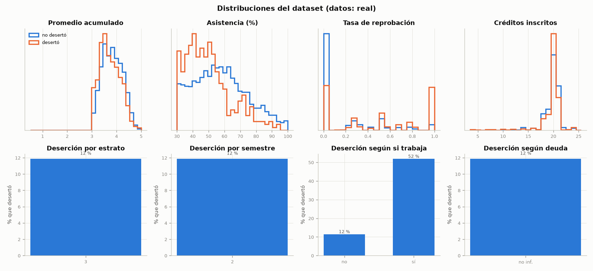

# Resumen del dataset

> Datos cargados desde `datos/reales/estudiantes_reales.csv` con `cargar_datos_reales()`.

| Concepto | Valor |
|---|---|
| Filas leídas | 5808 |
| Válidas con etiqueta | 5752 |
| Descartadas | 56 |
| Tasa de deserción | 11.9 % |
| Sin deuda informada | 5752 |

## Descartes por motivo

| Motivo | Filas |
|---|---|
| abstener(campo_faltante) | 36 |
| abstener(datos_contradictorios) | 20 |

