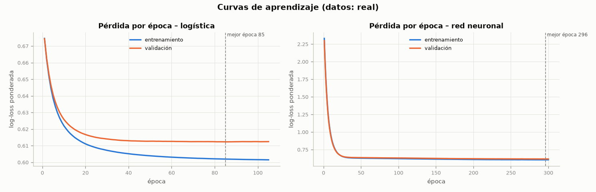

# Reporte de entrenamiento – base real

> Datos cargados desde `datos/reales/estudiantes_reales.csv` con `cargar_datos_reales()`.

Prueba: 901 estudiantes que ningún modelo vio (tasa de deserción 11.4 %).

| Métrica en test | reglas (línea base) | regresión logística | red neuronal (MLP) |
|---|---|---|---|
| Log-loss | 0.4579 | 0.3248 | 0.3238 |
| Brier | 0.1445 | 0.0945 | 0.0950 |
| AUC-ROC | 0.7285 | 0.7432 | 0.7423 |
| F1 (alto) | 0.378 | 0.379 | 0.389 |
| Recall (alto) | 47.6% | 62.1% | 60.2% |
| Precisión (alto) | 31.4% | 27.2% | 28.7% |
| % en alto | 17.3% | 26.1% | 24.0% |

**Conclusión.** La red neuronal NO supera de forma relevante a la logística (AUC 0.742 vs 0.743); la logística es preferible porque es explicable. La línea base por reglas queda cerca (AUC 0.729, +0.015 frente a la logística) y su probabilidad (puntaje/100) está mal calibrada (Brier 0.145 vs 0.094). Se midió con estudiantes reales que ningún modelo vio al entrenar.

### Sin los casos evidentes (811 estudiantes, tasa 8.9 %)

Casos evidentes = no aprobó ninguna materia del periodo anterior: 90 en prueba, de los que desertó el 34.4 %.

| Métrica sin evidentes | reglas (línea base) | regresión logística | red neuronal (MLP) |
|---|---|---|---|
| Log-loss | 0.4027 | 0.2852 | 0.2841 |
| Brier | 0.1198 | 0.0783 | 0.0788 |
| AUC-ROC | 0.6753 | 0.7033 | 0.7029 |
| F1 (alto) | 0.259 | 0.304 | 0.312 |
| Recall (alto) | 25.0% | 45.8% | 43.1% |
| Precisión (alto) | 26.9% | 22.8% | 24.4% |
| % en alto | 8.3% | 17.9% | 15.7% |

**Contra una sola variable.** La mejor variable sola en prueba es `tasa_reprobacion` (AUC 0.7285); sin casos evidentes, `tasa_reprobacion` (0.6776).

Cortes: medio ≥ 23, alto ≥ 34. No se pueden cumplir las dos condiciones a la vez: se priorizó no pasar del 25% de estudiantes en alto (detecta 54%); el resto de la detección queda en medio.

Importancia por permutación en prueba, por variable:

| Variable | Logística | Red neuronal |
|---|---|---|
| promedio acumulado | 8.1 % | 10.3 % |
| créditos inscritos | 0.0 % | 0.0 % |
| materias cursadas | 17.0 % | 19.3 % |
| tasa de reprobación | 31.7 % | 28.9 % |
| asistencia | 38.9 % | 39.4 % |
| trabaja | 4.3 % | 2.2 % |

Por grupo de variables correlacionadas (lo que mide el tope de 35 %):

| Grupo | Logística | Red neuronal |
|---|---|---|
| promedio acumulado + tasa de reprobación | 48.4 % | 48.0 % |
| créditos inscritos | 0.0 % | 0.0 % |
| materias cursadas | 11.7 % | 13.4 % |
| asistencia | 35.9 % | 36.1 % |
| trabaja | 4.0 % | 2.6 % |

Tope cumplido: logística **no**, red neuronal **no**.

## Pruebas de estrés (ronda 4, modelos de la corrida principal)

| Versión | Pasan | Detalle |
|---|---|---|
| Ronda 4 – modo reglas (referencia) | 41/45 | contrato: 23/23; propiedades: 7/7; nuevos: 11/15 |
| Ronda 4 – modo aprendido, logística | 45/45 | contrato: 23/23; propiedades: 7/7; nuevos: 15/15 |
| Ronda 4 – modo aprendido, red neuronal | 45/45 | contrato: 23/23; propiedades: 7/7; nuevos: 15/15 |

Historial: en la versión 1 la red neuronal fallaba P04 (en T11, bajar la asistencia de 89.5 a 87 bajaba el puntaje de 32 a 31): una MLP sin restricciones no garantiza monotonía en combinaciones raras. La versión 2 restringe los signos (W1 con signo fijo en promedio, tasa de reprobación y asistencia; W2 y W3 ≥ 0), así que es monótona por construcción y pasa 45/45. La logística (modelo principal) pasa 45/45 desde la primera versión: su tarjeta es lineal y cada peso aprendido tiene el signo esperado; no se le impuso ninguna restricción. El modo reglas se corre como referencia y falla U06, U07, U12 y U13: sus puntos van por escalones (una centésima de promedio cambia 15 puntos) y deja en bajo una asistencia de 0 % o perder todas las materias con promedio alto. Es un hallazgo sobre las reglas del contrato, no un error de código; las reglas no se cambian. El oráculo de la ronda 4 es un BORRADOR escrito por el modelo y debe firmarlo el equipo.

Resultados de la versión 1 (antes de la corrección):

| Versión | Pasan | Fallan |
|---|---|---|
| Ronda 4 – modo reglas (referencia) (v1) | 41/45 | U06, U07, U12, U13 |
| Ronda 4 – modo aprendido, logística (v1) | 45/45 | – |
| Ronda 4 – modo aprendido, red neuronal (v1) | 44/45 | P04 |

## Supuestos [SUPUESTO]

1. Despliegue: Vercel no ejecuta Streamlit; la web de Vercel es HTML estático + funciones Python (solo NumPy). Streamlit queda para uso local.
2. Población válida = pregrado, activo, semestres 2–4 (heredado del contrato).
3. Semilla 2026 para datos, división y modelos; 2027–2031 para estabilidad.
4. `id_estudiante`, `nivel_formacion` y `estado_matricula` no son predictores (identificador y constantes).
5. Estrato se trata como ordinal numérico (1–6).
6. Se prefiere `tasa_reprobacion` sobre `materias_reprobadas` y `creditos_inscritos` sobre `materias_cursadas_periodo_anterior` cuando |r| > 0.8.
7. Se estandarizan todas las variables, también las binarias, para que L2 las trate por igual.
8. Deuda no informada → se imputa el valor que no reduce el riesgo (1 si su peso es positivo); en la MLP se toma la mayor probabilidad entre 0 y 1.
9. Pesos por clase n/(2·n_clase); la probabilidad reportada se corrige restando ln(w+/w-) al logit.
10. Arquitectura de la MLP: n → 16 → 8 → 1, ReLU, dropout 0.2, Adam (η = 0.001), L2 = 1e-4.
11. MLP versión 2 (tras la ronda 4): monótona por construcción en promedio (−), tasa de reprobación (+) y asistencia (−), con signo fijo en W1 y W2, W3 ≥ 0.
12. Logística: SGD por mini-lotes de 256, η = 0.01, L2 = 1e-3, early stopping con paciencia 20.
13. Puntos de la tarjeta anclados a los rangos del contrato (0 puntos = valor de menor riesgo posible).
14. Objetivo de cortes: alto ≥ 70 % de recall con ≤ 25 % de estudiantes; en bajo ≤ 10 % de los desertores. Con datos reales, si no se puede, se respeta el 25 % en alto y el resto de la detección queda en medio.
15. R3.4 fuerza nivel alto en modo aprendido sin cambiar el puntaje.
16. Probabilidad de la línea base = puntaje/100 recortado a [0.01, 0.99].
17. "Marcado en riesgo" = nivel alto (también se reporta medio + alto).
18. Tope de dominancia 35 % de la importancia por permutación, medido por GRUPO de variables correlacionadas (|r| ≥ 0,5); se decide en train con un margen de 2 puntos, y el freno se detiene antes de que el modelo deje de ganarle (por 0,01 de AUC en train) a la mejor variable sola.
19. Colapso en ablación = caída de AUC > 0.10 al quitar una variable.
20. La ablación y la estabilidad de pesos se hacen sobre la logística (modelo principal); para la MLP se reporta la importancia con 5 semillas.
21. Ronda 4: los casos con resultado se verifican con propiedades, no con el puntaje exacto del oráculo (que no se modifica).

## De la fuente al contrato (Universitat Politècnica de València (España))

Primer año de grado, cohortes 2021 y 2022, con lo que se sabía al terminar el primer cuatrimestre.

| Campo | De dónde sale | Tipo |
|---|---|---|
| `id_estudiante` | Código propio por cohorte (UPV21-0001…). La fuente solo trae un identificador cifrado. | directo |
| `nivel_formacion` | Siempre pregrado: solo entran titulaciones de grado (180 créditos o más). | directo |
| `estado_matricula` | Siempre activo: quien ya había anulado toda su matrícula antes de febrero no entra (ya se fue; no hay nada que predecir). | directo |
| `semestre` | Siempre 2: se usa solo lo que se sabía al terminar el primer cuatrimestre, para avisar temprano. | supuesto |
| `promedio_acumulado` | Nota media de las asignaturas APROBADAS del primer cuatrimestre, como la nota media del expediente en España. La escala española (0 a 10, se aprueba con 5) se pasa a la del contrato (0 a 5, se aprueba con 3,0) alineando el aprobado. Quien no aprobó ninguna queda en 0,0; quien no tiene ninguna nota, sin dato. | aproximado |
| `materias_cursadas_periodo_anterior` | Asignaturas del primer cuatrimestre en las que estaba matriculado. La fuente no dice de qué cuatrimestre es cada asignatura: se deduce de cuándo tiene actividad el aula virtual de esa asignatura (80 % o más entre septiembre y enero = primer cuatrimestre). Las anuales no cuentan. | aproximado |
| `materias_reprobadas` | De esas, las suspendidas o sin nota (no presentarse cuenta como reprobar). | directo |
| `creditos_inscritos` | Créditos ECTS del primer cuatrimestre (las anuales cuentan la mitad) × 2/3, para que la carga habitual (30 ECTS) quede en 20 y la máxima del contrato (25) en 37,5 ECTS. No se usan los del segundo cuatrimestre: se pueden cambiar en febrero, después del corte. | aproximado |
| `porcentaje_asistencia` | La fuente no registra asistencia. Se usa la presencia de septiembre a enero como el promedio de tres porcentajes: días conectado al wifi del campus (sobre 78), días que entró al aula virtual de cada asignatura (sobre 65.5) y tareas o cuestionarios entregados por asignatura (sobre 16). Cada referencia es lo que alcanza el 5 % más presente; tope de 100. Quien no tiene registro de wifi (la fuente no dice si no fue o si no se registró) se mide solo con el aula virtual. | aproximado |
| `estrato` | Sin dato: la fuente trae los estudios del padre y de la madre como letras anonimizadas sin significado publicado, así que no se pueden ordenar. Se pone 3 a todos; al no variar, el modelo no lo usa. | supuesto |
| `trabaja` | Se marca «sí» a quien está matriculado a tiempo parcial. La fuente no dice si trabaja. | aproximado |
| `deuda_matricula` | Sin informar (es opcional en el contrato). La fuente marca impagos, pero ninguno de los estudiantes con impago figura como abandono: la etiqueta los trata aparte y el dato enseñaría lo contrario de lo real. | supuesto |
| `deserto` | 1 si la fuente lo marca como abandono («A»: dos cursos seguidos sin matricularse en la titulación); 0 si no. La letra no está documentada: se dedujo de los datos. | supuesto |
