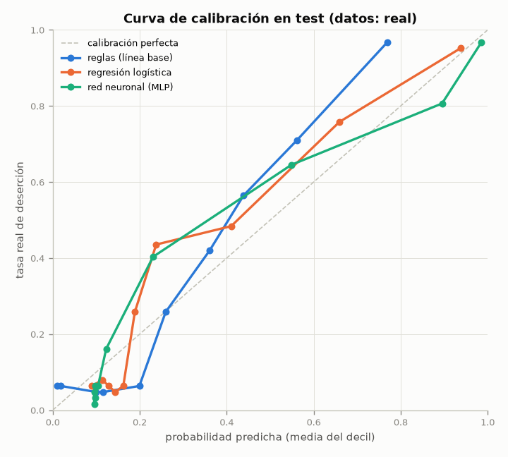

# Reporte de entrenamiento – datos cargados desde CSV

> Datos cargados desde `datos/reales/estudiantes_reales.csv` con `cargar_datos_reales()`.

| Métrica en test | reglas (línea base) | regresión logística | red neuronal (MLP) |
|---|---|---|---|
| Log-loss | 0.4192 | 0.4132 | 0.3440 |
| Brier | 0.1290 | 0.1290 | 0.1022 |
| AUC-ROC | 0.8831 | 0.8764 | 0.9164 |
| Recall (alto) | 39.7% | 70.9% | 68.8% |
| Precisión (alto) | 90.8% | 73.1% | 83.0% |
| % en alto | 13.9% | 30.9% | 26.4% |

**Conclusión.** La red neuronal ordena algo mejor que la logística (AUC 0.916 vs 0.876), a costa de perder la tarjeta de puntaje explicable. La línea base por reglas queda cerca (AUC 0.883, -0.007 frente a la logística) y su probabilidad (puntaje/100) está mal calibrada (Brier 0.129 vs 0.129). Se midió con estudiantes reales que ningún modelo vio al entrenar.

Cortes: medio ≥ 23, alto ≥ 29. No se pueden cumplir las dos condiciones a la vez: se priorizó el recall (≥ 70 %).

Importancia por permutación (logística): promedio acumulado 28.3 %, créditos inscritos 2.0 %, tasa de reprobación 28.1 %, asistencia 7.8 %, estrato 0.0 %, trabaja 2.0 %, deuda de matrícula 31.9 %

## Pruebas de estrés del modo aprendido (ronda 4)

| Versión | Pasan | Detalle |
|---|---|---|
| Ronda 4 – modo reglas (referencia) | 41/45 | contrato: 23/23; propiedades: 7/7; nuevos: 11/15 |
| Ronda 4 – modo aprendido, logística | 45/45 | contrato: 23/23; propiedades: 7/7; nuevos: 15/15 |
| Ronda 4 – modo aprendido, red neuronal | 45/45 | contrato: 23/23; propiedades: 7/7; nuevos: 15/15 |

Historial: en la versión 1 la red neuronal fallaba P04 (en T11, bajar la asistencia de 89.5 a 87 bajaba el puntaje de 32 a 31): una MLP sin restricciones no garantiza monotonía en combinaciones raras. La versión 2 restringe los signos (W1 con signo fijo en promedio, tasa de reprobación y asistencia; W2 y W3 ≥ 0), así que es monótona por construcción y pasa 45/45. La logística (modelo principal) pasa 45/45 desde la primera versión: su tarjeta es lineal y cada peso aprendido tiene el signo esperado; no se le impuso ninguna restricción. El modo reglas se corre como referencia y falla U06, U07, U12 y U13: sus puntos van por escalones (una centésima de promedio cambia 15 puntos) y deja en bajo una asistencia de 0 % o perder todas las materias con promedio alto. Es un hallazgo sobre las reglas del contrato, no un error de código; las reglas no se cambian. El oráculo de la ronda 4 es un BORRADOR escrito por el modelo y debe firmarlo el equipo.

Resultados de la versión 1 (antes de la corrección):

| Versión | Pasan | Fallan |
|---|---|---|
| Ronda 4 – modo reglas (referencia) (v1) | 41/45 | U06, U07, U12, U13 |
| Ronda 4 – modo aprendido, logística (v1) | 45/45 | – |
| Ronda 4 – modo aprendido, red neuronal (v1) | 44/45 | P04 |

## Supuestos [SUPUESTO]

1. Despliegue: Vercel no ejecuta Streamlit; la web de Vercel es HTML estático + funciones Python (solo NumPy). Streamlit queda para uso local.
2. Población válida = pregrado, activo, semestres 2–4 (heredado del contrato).
3. Tasa base de deserción simulada: 18 % (SPADIES 2023 reporta ~12 % anual; la deserción se concentra en los primeros semestres).
4. Función latente de la etiqueta (no lineal, con interacciones trabaja×asistencia y deuda×estrato, y ruido N(0, 0.6)); ver la fórmula en la sección 1.
5. Factores latentes S (socioeconómico) y A (académico) con correlación 0.30; distribución de estrato 22/35/27/10/4/2 %.
6. 3 % de registros defectuosos (8 tipos) y 8 % de registros válidos sin `deuda_matricula`.
7. Semilla 2026 para datos, división y modelos; 2027–2031 para estabilidad.
8. `id_estudiante`, `nivel_formacion` y `estado_matricula` no son predictores (identificador y constantes).
9. Estrato se trata como ordinal numérico (1–6).
10. Se prefiere `tasa_reprobacion` sobre `materias_reprobadas` y `creditos_inscritos` sobre `materias_cursadas_periodo_anterior` cuando |r| > 0.8.
11. Se estandarizan todas las variables, también las binarias, para que L2 las trate por igual.
12. Deuda no informada → se imputa el valor que no reduce el riesgo (1 si su peso es positivo); en la MLP se toma la mayor probabilidad entre 0 y 1.
13. Pesos por clase n/(2·n_clase); la probabilidad reportada se corrige restando ln(w+/w-) al logit.
14. Arquitectura de la MLP: n → 16 → 8 → 1, ReLU, dropout 0.2, Adam (η = 0.001), L2 = 1e-4.
15. MLP versión 2 (tras la ronda 4): monótona por construcción en promedio (−), tasa de reprobación (+) y asistencia (−), con signo fijo en W1 y W2, W3 ≥ 0.
16. Logística: SGD por mini-lotes de 256, η = 0.01, L2 = 1e-3, early stopping con paciencia 20.
17. Puntos de la tarjeta anclados a los rangos del contrato (0 puntos = valor de menor riesgo posible).
18. Objetivo de cortes: alto ≥ 70 % de recall con ≤ 25 % de estudiantes; en bajo ≤ 10 % de los desertores. Si no se puede, se prioriza el recall.
19. R3.4 fuerza nivel alto en modo aprendido sin cambiar el puntaje.
20. Probabilidad de la línea base = puntaje/100 recortado a [0.01, 0.99].
21. "Marcado en riesgo" = nivel alto (también se reporta medio + alto).
22. Tope de dominancia 35 % de la importancia por permutación; se decide con la importancia en train y un margen de 2 puntos.
23. Colapso en ablación = caída de AUC > 0.10 al quitar una variable.
24. La ablación y la estabilidad de pesos se hacen sobre la logística (modelo principal); para la MLP se reporta la importancia con 5 semillas.
25. Ronda 4: los casos con resultado se verifican con propiedades, no con el puntaje exacto del oráculo (que no se modifica).
