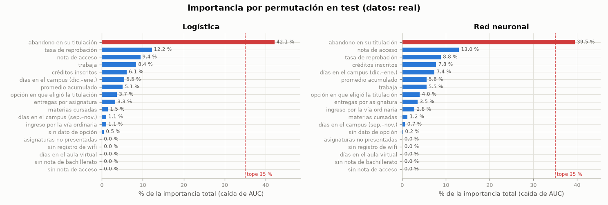

# Reporte de entrenamiento – base real

> Datos cargados desde `datos/reales/estudiantes_reales.csv` con `cargar_datos_reales()`.

Prueba: 864 estudiantes que ningún modelo vio (tasa de deserción 11.9 %).

| Métrica en test | reglas (línea base) | regresión logística | red neuronal (MLP) |
|---|---|---|---|
| Log-loss | 0.4328 | 0.2963 | 0.2928 |
| Brier | 0.1336 | 0.0860 | 0.0849 |
| AUC-ROC | 0.7130 | 0.7977 | 0.8067 |
| F1 (alto) | 0.383 | 0.476 | 0.464 |
| Recall (alto) | 39.8% | 63.1% | 66.0% |
| Precisión (alto) | 36.9% | 38.2% | 35.8% |
| % en alto | 12.8% | 19.7% | 22.0% |

**Conclusión.** La red neuronal ordena algo mejor que la logística (AUC 0.807 vs 0.798), a costa de perder la tarjeta de puntaje explicable. La línea base por reglas queda por debajo (AUC 0.713, +0.085 frente a la logística) y su probabilidad (puntaje/100) está mal calibrada (Brier 0.134 vs 0.086). Se midió con estudiantes reales que ningún modelo vio al entrenar.

### Sin los casos evidentes (801 estudiantes, tasa 8.4 %)

Casos evidentes = no aprobó ninguna materia del periodo anterior: 63 en prueba, de los que desertó el 57.1 %.

| Métrica sin evidentes | reglas (línea base) | regresión logística | red neuronal (MLP) |
|---|---|---|---|
| Log-loss | 0.4083 | 0.2596 | 0.2571 |
| Brier | 0.1229 | 0.0706 | 0.0703 |
| AUC-ROC | 0.5888 | 0.7231 | 0.7401 |
| F1 (alto) | 0.087 | 0.333 | 0.330 |
| Recall (alto) | 7.5% | 43.3% | 47.8% |
| Precisión (alto) | 10.4% | 27.1% | 25.2% |
| % en alto | 6.0% | 13.4% | 15.9% |

**Contra una sola variable.** La mejor variable sola en prueba es `tasa_reprobacion` (AUC 0.7179); sin casos evidentes, `abandono_titulacion` (0.7063).

Cortes: medio ≥ 36, alto ≥ 42. No se pueden cumplir las dos condiciones a la vez: se priorizó no pasar del 25% de estudiantes en alto (detecta 68%); el resto de la detección queda en medio.

Importancia por permutación en prueba, por variable:

| Variable | Logística | Red neuronal |
|---|---|---|
| promedio acumulado | 5.1 % | 5.6 % |
| créditos inscritos | 6.1 % | 7.8 % |
| materias cursadas | 1.5 % | 1.2 % |
| tasa de reprobación | 12.2 % | 8.8 % |
| trabaja | 8.4 % | 5.5 % |
| asignaturas no presentadas | 0.0 % | 0.0 % |
| días en el campus (sep.–nov.) | 1.1 % | 0.7 % |
| días en el campus (dic.–ene.) | 5.5 % | 7.4 % |
| sin registro de wifi | 0.0 % | 0.0 % |
| días en el aula virtual | 0.0 % | 0.0 % |
| entregas por asignatura | 3.3 % | 3.5 % |
| nota de acceso | 9.4 % | 13.0 % |
| sin nota de acceso | 0.0 % | 0.0 % |
| sin nota de bachillerato | 0.0 % | 0.0 % |
| opción en que eligió la titulación | 3.7 % | 4.0 % |
| sin dato de opción | 0.5 % | 0.2 % |
| ingreso por la vía ordinaria | 1.1 % | 2.8 % |
| abandono en su titulación | 42.1 % | 39.5 % |

Por grupo de variables correlacionadas (lo que mide el tope de 35 %):

| Grupo | Logística | Red neuronal |
|---|---|---|
| promedio acumulado + materias cursadas + tasa de reprobación + asignaturas no presentadas | 31.1 % | 21.8 % |
| créditos inscritos + trabaja + nota de acceso + sin nota de acceso + sin nota de bachillerato + opción en que eligió la titulación + sin dato de opción + ingreso por la vía ordinaria | 15.1 % | 20.2 % |
| días en el campus (sep.–nov.) + días en el campus (dic.–ene.) + sin registro de wifi + días en el aula virtual + entregas por asignatura | 18.3 % | 22.6 % |
| abandono en su titulación | 35.6 % | 35.3 % |

Tope cumplido: logística **no**, red neuronal **no**.

### Qué aporta cada fuente (nuestros modelos, AUC en prueba)

| Variables | Logística | Logística sin evidentes | Red | Red sin evidentes |
|---|---|---|---|---|
| notas | 0.732 | 0.618 | 0.699 | 0.566 |
| actividad | 0.659 | 0.578 | 0.662 | 0.582 |
| admision | 0.718 | 0.653 | 0.719 | 0.658 |
| titulacion | 0.709 | 0.706 | 0.707 | 0.704 |
| antes_de_notas | 0.769 | 0.716 | 0.778 | 0.724 |
| todo | 0.815 | 0.754 | 0.819 | 0.758 |

### Verificación con scikit-learn (misma división, variables e imputación)

| Modelo | Propio | scikit-learn | Diferencia |
|---|---|---|---|
| logistica_libre | 0.8215 | 0.8214 | +0.0002 |
| logistica_sin_tope | 0.8152 | 0.8214 | -0.0062 |
| logistica_final | 0.7977 | 0.8025 | -0.0047 |
| red | 0.8067 | 0.7647 | +0.0420 |

`logistica_libre` es la propia sin restricción de signo ni tope: la única comparable con scikit-learn. Las otras dos llevan la restricción de signo, que scikit-learn no tiene.

### Contrato ampliado

Ver `CONTRATO_AMPLIADO.md`. Imputación con la mediana de entrenamiento: `nota_media_cuatrimestre` 6.6, `nota_minima_cuatrimestre` 5.5, `asignaturas_no_presentadas` 0, `dias_campus_sep_nov` 39, `dias_campus_dic_ene` 15, `dias_aula_virtual` 36.25, `entregas_por_asignatura` 4, `nota_acceso` 10.728, `nota_bachillerato` 7.788, `opcion_titulacion` 1. Tasa general de abandono 0.119, 39 titulaciones, suavizado 20.

Decisiones de la Fase 3: se quita `semestre`; se quita `estrato`; se quita `deuda_matricula`; se quita `sin_aula_virtual`; se quita `materias_reprobadas`; se quita `nota_media_cuatrimestre`; se quita `nota_bachillerato`; se quita `nota_minima_cuatrimestre`; se quita `porcentaje_asistencia`.

## Pruebas de estrés (ronda 4, modelos de la corrida principal)

| Versión | Pasan | Detalle |
|---|---|---|
| Ronda 4 – modo reglas (referencia) | 41/45 | contrato: 23/23; propiedades: 7/7; nuevos: 11/15 |
| Ronda 4 – modo aprendido, logística | 45/45 | contrato: 23/23; propiedades: 7/7; nuevos: 15/15 |
| Ronda 4 – modo aprendido, red neuronal | 45/45 | contrato: 23/23; propiedades: 7/7; nuevos: 15/15 |

Historial: en la versión 1 la red neuronal fallaba P04 (en T11, bajar la asistencia de 89.5 a 87 bajaba el puntaje de 32 a 31): una MLP sin restricciones no garantiza monotonía en combinaciones raras. La versión 2 restringe los signos (W1 con signo fijo en promedio, tasa de reprobación y asistencia; W2 y W3 ≥ 0), así que es monótona por construcción y pasa 45/45. La logística (modelo principal) pasa 45/45 desde la primera versión: su tarjeta es lineal y cada peso aprendido tiene el signo esperado; no se le impuso ninguna restricción. El modo reglas se corre como referencia y falla U06, U07, U12 y U13: sus puntos van por escalones (una centésima de promedio cambia 15 puntos) y deja en bajo una asistencia de 0 % o perder todas las materias con promedio alto. Es un hallazgo sobre las reglas del contrato, no un error de código; las reglas no se cambian. El oráculo de la ronda 4 es un BORRADOR escrito por el modelo y debe firmarlo el equipo.

Resultados de la versión 1 (antes de la corrección):

| Versión | Pasan | Fallan |
|---|---|---|
| Ronda 4 – modo reglas (referencia) (v1) | 41/45 | U06, U07, U12, U13 |
| Ronda 4 – modo aprendido, logística (v1) | 45/45 | – |
| Ronda 4 – modo aprendido, red neuronal (v1) | 44/45 | P04 |

## Supuestos [SUPUESTO]

1. Despliegue: Vercel no ejecuta Streamlit; la web de Vercel es HTML estático + funciones Python (solo NumPy). Streamlit queda para uso local.
2. Población válida = pregrado, activo, semestres 2–4 (heredado del contrato).
3. Semilla 2026 para datos, división y modelos; 2027–2031 para estabilidad.
4. `id_estudiante`, `nivel_formacion` y `estado_matricula` no son predictores (identificador y constantes).
5. Estrato se trata como ordinal numérico (1–6).
6. Se prefiere `tasa_reprobacion` sobre `materias_reprobadas` y `creditos_inscritos` sobre `materias_cursadas_periodo_anterior` cuando |r| > 0.8.
7. Se estandarizan todas las variables, también las binarias, para que L2 las trate por igual.
8. Deuda no informada → se imputa el valor que no reduce el riesgo (1 si su peso es positivo); en la MLP se toma la mayor probabilidad entre 0 y 1.
9. Pesos por clase n/(2·n_clase); la probabilidad reportada se corrige restando ln(w+/w-) al logit.
10. Arquitectura de la MLP: n → 16 → 8 → 1, ReLU, dropout 0.2, Adam (η = 0.001), L2 = 1e-4.
11. MLP versión 2 (tras la ronda 4): monótona por construcción en promedio (−), tasa de reprobación (+) y asistencia (−), con signo fijo en W1 y W2, W3 ≥ 0.
12. Logística: SGD por mini-lotes de 256, η = 0.01, L2 = 1e-3, early stopping con paciencia 20.
13. Puntos de la tarjeta anclados a los rangos del contrato (0 puntos = valor de menor riesgo posible).
14. Objetivo de cortes: alto ≥ 70 % de recall con ≤ 25 % de estudiantes; en bajo ≤ 10 % de los desertores. Con datos reales, si no se puede, se respeta el 25 % en alto y el resto de la detección queda en medio.
15. R3.4 fuerza nivel alto en modo aprendido sin cambiar el puntaje.
16. Probabilidad de la línea base = puntaje/100 recortado a [0.01, 0.99].
17. "Marcado en riesgo" = nivel alto (también se reporta medio + alto).
18. Tope de dominancia 35 % de la importancia por permutación, medido por GRUPO de variables correlacionadas (|r| ≥ 0,5; con el contrato ampliado, por FUENTE del dato); se decide en train con un margen de 2 puntos, y el freno se detiene antes de que el modelo deje de ganarle (por 0,01 de AUC en train) a la mejor variable sola.
19. Colapso en ablación = caída de AUC > 0.10 al quitar una variable.
20. La ablación y la estabilidad de pesos se hacen sobre la logística (modelo principal); para la MLP se reporta la importancia con 5 semillas.
21. Ronda 4: los casos con resultado se verifican con propiedades, no con el puntaje exacto del oráculo (que no se modifica).

## De la fuente al contrato (Universitat Politècnica de València (España))

Primer año de grado, cohortes 2021 y 2022, con lo que se sabía al terminar el primer cuatrimestre. Sin los 334 estudiantes con impago de matrícula: la fuente no marca a ninguno como abandono.

| Campo | De dónde sale | Tipo |
|---|---|---|
| `id_estudiante` | Código propio por cohorte (UPV21-0001…). La fuente solo trae un identificador cifrado. | directo |
| `nivel_formacion` | Siempre pregrado: solo entran titulaciones de grado (180 créditos o más). | directo |
| `estado_matricula` | Siempre activo: quien ya había anulado toda su matrícula antes de febrero no entra (ya se fue; no hay nada que predecir). | directo |
| `semestre` | Siempre 2: se usa solo lo que se sabía al terminar el primer cuatrimestre, para avisar temprano. | supuesto |
| `promedio_acumulado` | Nota media de las asignaturas APROBADAS del primer cuatrimestre, como la nota media del expediente en España. La escala española (0 a 10, se aprueba con 5) se pasa a la del contrato (0 a 5, se aprueba con 3,0) alineando el aprobado. Quien no aprobó ninguna queda en 0,0; quien no tiene ninguna nota, sin dato. | aproximado |
| `materias_cursadas_periodo_anterior` | Asignaturas del primer cuatrimestre en las que estaba matriculado. La fuente no dice de qué cuatrimestre es cada asignatura: se deduce de cuándo tiene actividad el aula virtual de esa asignatura (80 % o más entre septiembre y enero = primer cuatrimestre). Las anuales no cuentan. | aproximado |
| `materias_reprobadas` | De esas, las suspendidas o sin nota (no presentarse cuenta como reprobar). | directo |
| `creditos_inscritos` | Créditos ECTS del primer cuatrimestre (las anuales cuentan la mitad) × 2/3, para que la carga habitual (30 ECTS) quede en 20 y la máxima del contrato (25) en 37,5 ECTS. No se usan los del segundo cuatrimestre: se pueden cambiar en febrero, después del corte. | aproximado |
| `porcentaje_asistencia` | La fuente no registra asistencia. Se usa la presencia de septiembre a enero como el promedio de tres porcentajes: días conectado al wifi del campus (sobre 78), días que entró al aula virtual de cada asignatura (sobre 65.5) y tareas o cuestionarios entregados por asignatura (sobre 16). Cada referencia es lo que alcanza el 5 % más presente; tope de 100. Quien no tiene registro de wifi (la fuente no dice si no fue o si no se registró) se mide solo con el aula virtual. | aproximado |
| `estrato` | Sin dato: la fuente trae los estudios del padre y de la madre como letras anonimizadas sin significado publicado, así que no se pueden ordenar. Se pone 3 a todos; al no variar, el modelo no lo usa. | supuesto |
| `trabaja` | Se marca «sí» a quien está matriculado a tiempo parcial. La fuente no dice si trabaja. | aproximado |
| `deuda_matricula` | Sin informar (es opcional en el contrato). La fuente marca impagos, pero ninguno de los 334 estudiantes con impago figura como abandono: la etiqueta los trata aparte. Por eso esos estudiantes no entran en la base (no se sabe si abandonaron) y el dato no se usa. | supuesto |
| `nota_media_cuatrimestre` | Media de TODAS las notas del primer cuatrimestre (también las suspendidas), en la escala original 0 a 10. Sin dato si no se presentó a ninguna. | directo |
| `nota_minima_cuatrimestre` | La nota más baja entre las presentadas del primer cuatrimestre (0 a 10). | directo |
| `asignaturas_no_presentadas` | Asignaturas del primer cuatrimestre sin nota. | directo |
| `dias_campus_sep_nov` | Días conectado al wifi del campus en septiembre, octubre y noviembre. Sin dato si la fuente no tiene ningún registro de wifi del estudiante (no dice si no fue o si no se registró). | directo |
| `dias_campus_dic_ene` | Lo mismo, en diciembre y enero (la época de exámenes). | directo |
| `dias_aula_virtual` | Días que entró al aula virtual, promedio por asignatura del primer cuatrimestre (sept.–enero). | directo |
| `entregas_por_asignatura` | Tareas y cuestionarios entregados en el aula virtual, promedio por asignatura (sept.–enero). | directo |
| `nota_acceso` | Nota de acceso a la universidad, sobre 14. | directo |
| `nota_bachillerato` | Nota media del bachillerato, sobre 10. | directo |
| `opcion_titulacion` | En qué opción pidió la titulación (1 = primera). | directo |
| `tipo_ingreso` | Vía de ingreso tal como la codifica la fuente («NAP» = acceso ordinario, 9 de cada 10). | directo |
| `titulacion` | Titulación, renombrada T01…T45 de la más grande a la más chica (la fuente la trae cifrada). El modelo no usa el código: usa la tasa de abandono de esa titulación entre los estudiantes de entrenamiento. | directo |
| `deserto` | 1 si la fuente lo marca como abandono («A»: dos cursos seguidos sin matricularse en la titulación); 0 si no. La letra no está documentada: se dedujo de los datos. | supuesto |
